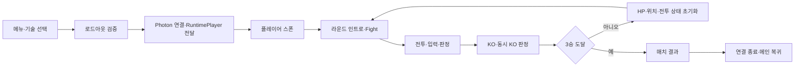
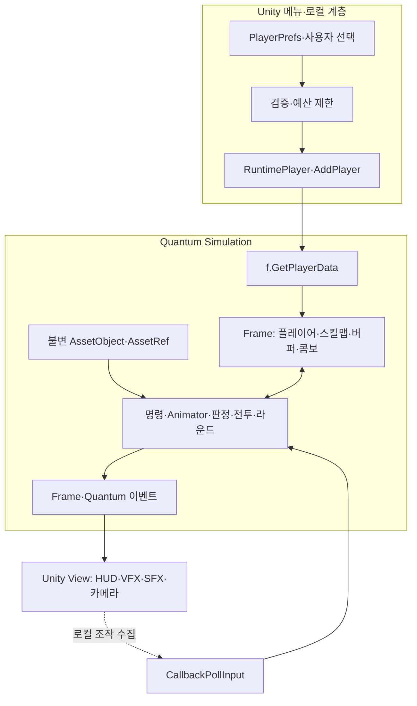

# Look-See-Do Fighter — 기술 포트폴리오 원천 자료

> 작성 기준: 2026-10-23, Asia/Seoul. 작성자 표기: **김석진**. 지원 방향: **AI Native 개발자 / 게임 클라이언트 개발자**.
> 이 문서는 기존 Markdown, 현재 설정·일부 핵심 소스, 저장된 검증 JSON을 대조한 자료집이다. 게임을 새로 실행하거나 검증 결과를 재생산한 보고서가 아니다.

## 1. 이 자료를 읽는 기준

### 1.1 조사 범위와 기준 상태

- 프로젝트 내부 Markdown **81개**를 목록화했다. 프로젝트·작업 관련 문서 76개와 SDK 참고 문서 5개로 구성된다. 빈 `pptstyle.md`와 임시 제작 인계 문서도 목록에 포함했다.
- 우선순위는 `AGENTS.md → docs/ai/current-state.md → 최근 작업 기록·증거 → Skill.md 및 작업별 SKILL.md → 초기 감사·계획`이다.
- `.codex/`에는 Markdown 대신 실제 설정인 `hooks.json`이 있어 별도로 확인했다. Markdown만으로 현재 동작을 단정하지 않기 위해 필요한 소스·설정과 기존 JSON 결과도 참고했다.
- `DinV`, `GabrielAguiarProductions`, `Matthew Guz` 폴더는 검색·열람에서 제외했다. `Library`, `Temp`, `obj`, `Logs`, `.vs`, `.git` 및 의존성 가상환경 내부 문서는 분석 대상에서 제외했다.
- SDK의 긴 변경 이력은 설치 버전과 관련 항목을 확인하는 참고 자료다. SDK 전체 소스·변경 이력 전수 감사나 외부 아트 저작권 감사를 수행한 것은 아니다.
- 분석 시작 기준 브랜치: `dev/Prototype`.
- 분석 시작 HEAD: `b40aea428812a98bb9d516e32434d5db5329fd51` — `Add looping stage backgrounds and configurable air hit push`.
- 작업 트리는 깨끗하지 않다. 최신 UI 소스·테스트·문서, 씬·렌더 설정, IDE 생성 파일, 사용자 이미지, 포트폴리오 제작물 등이 수정 또는 미추적 상태다. HEAD와 현재 로컬 전체를 같은 버전으로 취급하지 않는다.
- 최근 상태 문서의 조사 전 갱신 시각은 `2026-10-23T01:30:07+09:00`이다. 이 문서 작성 중 원격 fetch·새 커밋·Push·PR 생성은 수행하지 않았다.

분석 기준: [AGENTS.md](../AGENTS.md), [현재 작업 상태](ai/current-state.md), [개발 운영 지침](ai/development-workflow.md), [증거 작성 스킬](../.agents/skills/lsdf-portfolio-evidence/SKILL.md).

### 1.2 구현과 검증은 별개다

| 표기 | 의미 | 포트폴리오에서의 사용 |
|---|---|---|
| 구현 확인 | 현재 파일 또는 구체적인 변경 기록이 존재 | 무엇을 구현했는지 설명 가능. 전체 동작 보증은 별도 |
| 자동 PASS | 특정 후보·설정·job의 실행 성공 기록 | 해당 시점과 검사 범위에 한정해 수치 인용 |
| 사용자 확인 | 사용자가 직접 테스트 완료를 보고한 기록 | 수동 확인으로 표현. 자동 테스트 PASS로 바꾸지 않음 |
| FAIL | 실행했으나 실패한 결과 | 원인, 수정 여부와 이후 별도 근거까지 함께 제시 |
| 수정 후 미검증 | 실패 뒤 수정했지만 다시 실행하지 않음 | 완료 검증으로 소개하지 않음 |
| NOT RUN / UNKNOWN | 실행하지 않았거나 확인 근거 부족 | 미확인으로 유지 |
| 계획·후속 후보 | 로드맵·백로그·운영 지침의 목표 | 구현 성과에서 제외 |

오래된 문서의 “미완료”와 “현재 값”은 후속 기록으로 갱신해 해석해야 한다. 반대로 새 테스트 일부가 통과했다고 예전의 다른 실패까지 해소된 것으로 해석하면 안 된다. 이 문서는 결과를 합산한 총 테스트 수, AI 코드 작성 비율, 개발 속도 향상률을 산정하지 않는다.

## 2. 프로젝트 소개와 포트폴리오의 중심 이야기

### 2.1 프로젝트 목적

Look-See-Do Fighter는 **Photon Quantum 3 기반 2D 격투게임**이다. 플레이어가 방향·버튼 조합에 사용할 기술을 선택하고, 로드아웃을 전달해 온라인 전투와 라운드·매치 진행에 사용한다. 기존 전투 콘텐츠와 Animator 그래프를 기반으로 결정론 위험을 정리한 뒤 선입력, 라운드 진행, 공중 콤보, 카메라·VFX·HUD 표현을 보완한 프로젝트다.

이력서에서의 핵심은 “AI로 많은 코드를 생성했다”보다 다음 세 가지로 잡는 편이 근거와 잘 맞는다.

1. **네트워크 게임 상태의 소유권을 바로잡았다.** 로컬 저장과 시뮬레이션의 경계, 공유 에셋과 플레이어 실행 상태를 분리했다.
2. **기존 콘텐츠 계약을 보존하며 구조를 바꿨다.** 공격 37종의 타격 시점·수치·직렬화 참조와 시스템 순서를 기준으로 리팩토링했다.
3. **AI 협업을 조사·구현·실행 근거·실패 기록까지 연결했다.** Skills·Hooks·MCP·검사 도구·게시 절차를 프로젝트 규칙과 결합했다.

근거: [초기 감사](ai/architecture-audit.md), [초기 포트폴리오 근거](ai/evidence/2026-10-17-portfolio-summary.md), [잔여 리팩토링 결과](ai/refactor-remaining-result.md).

### 2.2 “1년 전 중단한 게임을 AI와 6일간 완성”의 표현 범위

| 항목 | 확인 가능한 내용 | 표현 시 한계 |
|---|---|---|
| 1년 전 중단 | 사용자가 제시한 프로젝트 배경이며 포트폴리오 제작 기록에 반영됨 | 실제 최초 제작일·중단일을 독립적으로 검증한 자료는 아님 |
| 6일 | 사용자가 작업 흐름을 대략 재구성하도록 허용함 | 기록은 2026-10-16~23에 걸침. 정확히 연속 6일 또는 총 작업시간의 증거는 없음 |
| 완성 | 전투·매치·표현 기능을 보완해 플레이 가능한 흐름을 확장 | 배포 빌드·모든 온라인 예외·모든 기술의 완전 검증까지 완료했다는 의미로 쓰면 안 됨 |
| AI 활용 | 조사, 패치, 테스트 작성·실행 보조, 문서·제작물 생산 기록이 있음 | 전체 게임·SDK·기존 콘텐츠를 AI가 6일 만에 새로 만들었다는 주장은 불가 |

권장 소개문:

> 중단했던 Quantum 3 격투게임을 다시 개발하며, AI와 협업해 상태 소유권과 전투 구조를 정리하고 선입력·3선승 진행·공중 콤보·표현 기능을 보완했습니다. 작업은 6단계 개발 과정으로 정리했으며, 실행된 테스트와 남은 검증 범위를 구분해 기록했습니다.

제출 시 “6일”을 제목으로 유지한다면 사용자 배경 설명임을 전제로 하고, 세부 슬라이드에서는 임의의 실제 날짜·시간을 만들지 않는다. 정확한 달력이 중요하지 않다는 사용자 허용은 성능·기간 수치를 발명해도 된다는 뜻이 아니다.

근거: [기존 발표 자료 제작 기록](ai/evidence/2026-10-22-portfolio-presentation.md), [Astra 재구성 기록](ai/evidence/2026-10-22-portfolio-astra-redesign.md), [제작 인계](../tmp/portfolio-astra/authoring-review.md).

### 2.3 기술 환경

| 구분 | 확인 내용 | 근거 |
|---|---|---|
| 엔진 | Unity `6000.3.26f1` | [ProjectVersion.txt](../ProjectSettings/ProjectVersion.txt) |
| 네트워크·시뮬레이션 | Photon Quantum `3.0.14.2241` | [SDK 변경 이력](../Assets/Photon/Quantum/CHANGELOG.md), [기존 검증 요약](ai/evidence/2026-10-17-portfolio-summary.md) |
| 언어·스키마 | C#, Quantum DSL `.qtn`, 설치된 CodeGen | [Simulation](../Assets/QuantumUser/Simulation), [CodeGen 설정](../Assets/QuantumUser/Editor/CodeGen/QuantumCodeGenSettings.User.cs) |
| 전투 계산 | `FP`, `FPVector2`, 정수 tick | [전투 수학](../Assets/QuantumUser/Simulation/LSDFCombatMath.cs), [입력 버퍼](../Assets/QuantumUser/Simulation/LSDFInputBuffer.cs) |
| 애니메이션 | Quantum Animator 애드온과 기존 그래프·Window Event | [공격 이벤트](../Assets/QuantumUser/Simulation/LSDF_Animator_Window_Event) |
| UI·표현 | Unity View, uGUI, TextMeshPro, 별도 `LSDF.View` 어셈블리 | [View asmdef](../Assets/QuantumUser/View/LSDF.View.asmdef) |
| 검증 | NUnit/Unity Test Framework, Photon 연결 fixture, Python 정적·게시 검사기 | [테스트 asmdef](../Assets/Tests/Editor/LSDF.Tests.asmdef), [도구](../tools/ai) |
| AI 작업 환경 | Codex 프로젝트 규칙·Skills·SessionStart Hook, Unity MCP 사용 기록 | [AI_SETUP.md](../AI_SETUP.md), [Hook.md](../Hook.md) |

## 3. 게임 시스템과 현재 구현 상태

### 3.1 플레이 흐름



이는 현재 구현과 후속 기록을 종합한 흐름이다. 같은 방 재대전, 제한시간 판정, 실제 재접속 정책을 이 그림에 포함하지 않았다.

### 3.2 기능별 구현·증거·남은 범위

| 기능 | 구현 내용 | 확인 근거 및 제한 |
|---|---|---|
| 기술 선택·비용 | 방향 7개 × 버튼 4개 = 28슬롯, 슬롯별 3종, 84개 비용, 기본 예산 140 | 메뉴·직렬화·로드아웃 검사 존재. 실제 사용자 접속 종료 원인까지 규명한 것은 아님 |
| 로드아웃 전달 | Unity 로컬 저장 → 검증 → RuntimePlayer → Frame 스킬맵 | 반복 AddPlayer·다른 로드아웃 Photon 검사 이력 |
| 결정론 계산 | 애니메이션 시간 FP 환산, 카운터 정수 6/5, 지속 상태 Frame 이관 | 어휘 검사 0건은 의미적 결정론 증명이 아님 |
| 공격 데이터 | 37종 공격의 정의·공통 히트박스 생성 분리 | 계약 검사와 대표 온라인 기술. 37종 온라인 조합 전수 검사는 아님 |
| 기본 전투 | 이동·대시·앉기·가드·패링·카운터·상중하단·벽 반응 관련 기존 경로 | 리팩토링과 후속 테스트가 일부 경로를 다룸. 전부 이번에 신규 제작한 기능은 아님 |
| 선입력 | 버튼 눌림 순간 방향·tick 저장, 최신 1개, 해제 후 실행, 홀드 반복 방지 | 후속 157개 전체 검사에 포함. 에셋 값 20tick, 새 객체 기본 10tick |
| KO·3선승 | KO 한 번 확정, 동시 KO 무득점, 결과·인트로, 3승 종료 | 역사적 Photon 3:2 매치 실행 근거. 최종 메인 복귀는 별도 후속 구현 |
| 메인 복귀 | verified 매치 종료 시 기존 DisconnectAsync 경로 호출, 중복 방지 | 사용자 테스트 완료·게시 기록. 상세 자동 fixture는 수정 후 미검증 이력 |
| 2P 테스트 입력 | 방향·버튼 시퀀스 설정과 CallbackPollInput 경로 | 테스트·디버깅 도구. 게임 AI 또는 자동 학습 기능으로 소개하지 않음 |
| 공중 상태·낙하 | Frame 기반 상승·복귀·낙하 단계, 재타격 궤적과 자연 낙하 | 여러 버전 후속 이력 존재. 고정 높이 방식은 중간 버전 |
| 공중 피격 중단 | 공격 라우팅·전이·트리거 취소, Air 진입, 소유 히트박스 만료 | 사용자 확인. 이전 자동 fixture 보정 후 미검증 범위 유지 |
| 5후속타·마무리 | 시동기 제외 후속타 수, 5타 및 지정 기술의 날리기·회복 | 단위·Frame·일부 Photon 근거. 과거 기상 관련 온라인 실패는 별도 |
| 공중 피해 | 시동기 100%, 후속 1타 70%, 2타 50%, 3~5타 30% | 실제 콤보 HitCount 사용. 최초 전체 검사 109 PASS/1 FAIL, 보정된 통합 fixture 미검증 |
| 공중 피격 밀림 | 실제 공격자 반대 방향 거리·시간 조절, 일반 후속타마다 재시작 | 99개 PASS. 후속 현재 Photon 공중 검사 1개 PASS. 타격감은 수동 확인 영역 |
| 공중 Sprite pivot | 후반 프레임 기준점 통일로 반복 재생 시 시각적 재상승 제거 | 66개 PASS. 물리 수식을 고친 사례가 아님 |
| Collider 중심 | 날아가기·기상 상태별 FP 중심 설정, 중심만 바뀌어도 반영 | 과거 93/94·99/100 결과와 사용자 확인 구분 |
| 체력바 흔들림 | verified 피격·HP 변화, 각 HUD 독립, 원점 복귀 | 후속 235개 PASS 범위에 포함. 사용자 강도 20 보존 |
| 카운터 줌 | 기술별 설정·동기 이벤트·단계별 복구 | 37개 설정은 기본 비활성. 이후 모든 실제 연출을 자동 검증했다는 의미 아님 |
| 카메라 흔들림·높이 | follow·zoom·shake 합성, Inspector 높이 | 일부 fixture 보정·프리뷰 프로브 실패 이력. 사용자 확인 기록 있음 |
| 히트 이펙트 | 경기 updater 소유 ViewComponent, 사용자 프리팹·수명·정렬 | 초기 수명/초기화 테스트 수정 후 미검증과 사용자 확인 함께 기록 |
| 호밍·패링 흰색 표시 | MPB 기반 오버레이, 알파·시간 설정, 상태 재표본화 | 런타임 초기화 보정 후 자동 미검증 이력 |
| 평면 배경 | 양쪽 카메라별 배경, 깊이 차이 보정, 줌·반전·레이어 대응 | 초기 실패 후 후속 배경 검사 29개 PASS |
| 무한 배경 | 카메라별 3개 타일 순환, 화면 밖 재배치, 큰 줌아웃 Tiled | 시각 배경 기능. Quantum 충돌 지형을 무한 생성하는 기능은 아님 |
| 이미지 HUD | 체력 배경·채움, 승리 배경·마크, Round1~5·Fight·승패 이미지 | 로컬 미커밋 변경. 최초 39개 PASS, 후속 크기 22개·UV 28개 PASS |
| 1P Sprite 반전 | 원래 HP 감소 방향 유지, 전체 Sprite atlas UV의 X만 반사 | 실제 mesh 검사 6개 포함 28개 PASS. GPU 색상·실제 대전은 별도 미실행 |
| KazumiHoming | 삭제된 적 클립 참조 조사, 사용자 Rp 클립 재연결·재베이크 | 현재 공격 이벤트가 비어 있다는 후속 기록. 기술 전체 복구 완료로 소개 불가 |

## 4. 기술 아키텍처

### 4.1 상태 소유권과 의존성



| 데이터·처리 | 소유 계층 | 이유 |
|---|---|---|
| HP·패배 수·입력 잠금·버퍼·콤보 단계·종료 tick | Frame 컴포넌트·전역 상태 | 재생·과거 Frame 복원에 함께 포함되어야 함 |
| 공격 수치·이동·매치·콤보 설정 | 불변 AssetObject, AssetRef | 여러 엔티티가 공유하는 설정을 실행 상태로 오염시키지 않음 |
| 현재 호출의 애니메이션 프레임·접촉 판정 임시값 | 지역변수 | 재계산 가능하고 프레임 간 보존할 필요가 없음 |
| 사용자가 고른 로컬 기술·저장 키 | 메뉴·Unity 로컬 계층 | 각 클라이언트의 저장값이 시뮬레이션 내부에서 임의로 읽히지 않게 함 |
| 카메라 보간·파티클 수명·UI 메시지 | View | 게임 판정 권위가 아니므로 float·Time 사용 가능 |
| 공격 판정·피해·회복·라운드 진행 | Quantum Simulation | Unity Animator·Transform·코루틴이 승패를 결정하지 않음 |

현재 [Quantum.Simulation.asmdef](../Assets/Photon/Quantum/Simulation/Quantum.Simulation.asmdef)의 `noEngineReferences`는 **false**다. 따라서 “컴파일 단계에서 모든 Unity 참조가 차단된다”는 주장은 부정확하다. 금지 API는 작업 규칙·정적 검사·리뷰로 관리하며, Inspector 속성·Preserve까지 모두 위반으로 취급하지 않는다.

[LSDF.View.asmdef](../Assets/QuantumUser/View/LSDF.View.asmdef)는 `Quantum.Simulation`, `Quantum.Unity`, `Unity.TextMeshPro`, `UnityEngine.UI`를 참조한다. 방향은 View가 Simulation을 읽는 구조다.

### 4.2 실제 시스템 등록 순서

실제 등록은 [Assets/Resources/LSDF_SystemConfig.asset](../Assets/Resources/LSDF_SystemConfig.asset)이다. 비어 있는 [SystemSetup.User.cs](../Assets/QuantumUser/Simulation/SystemSetup.User.cs)를 근거로 시스템이 없다고 판단하거나 중복 등록하면 안 된다.

```text
Culling3D → Physics3D → Culling2D → Physics2D
→ EntityPrototype → PlayerConnected → PlayerSpawn → Player
→ Animator → AnimatorBehaviour → AnimatorTriggers
→ Command → CollisionDestroy → Collision → Ingame
```

물리·Animator·명령·파괴 순서는 타격 시점과 트리거 소비에 영향을 준다. PlayerSystem을 partial·helper로 나눠도 등록 시스템 하나를 유지했다. 후속 Collider 수정에서 내부 Juggle·Collider 처리 순서에 영향을 준 경우는 별도 타이밍 변경으로 기록했다.

### 4.3 폴더·책임 지도

| 경로 | 책임·읽을 지점 |
|---|---|
| [Assets/QuantumUser/Simulation](../Assets/QuantumUser/Simulation) | 게임 결과를 결정하는 코드·스키마 |
| [LSDF_PlayerSystem.cs](../Assets/QuantumUser/Simulation/LSDF_PlayerSystem.cs) | 플레이어 갱신 진입점 |
| [PlayerSystem.Combat](../Assets/QuantumUser/Simulation/LSDF_PlayerSystem.Combat.cs), [Contacts](../Assets/QuantumUser/Simulation/LSDF_PlayerSystem.Contacts.cs) | 피격·접촉 책임 분리 |
| [LSDFPlayerMotion](../Assets/QuantumUser/Simulation/LSDFPlayerMotion.cs), [Health](../Assets/QuantumUser/Simulation/LSDFPlayerHealth.cs), [ContactPolicy](../Assets/QuantumUser/Simulation/LSDFContactPolicy.cs) | 이동·체력·접촉 정책 |
| [LSDFInputBuffer](../Assets/QuantumUser/Simulation/LSDFInputBuffer.cs), [CommandProcessor](../Assets/QuantumUser/Simulation/LSDFCommandProcessor.cs) | 입력 저장·만료·Animator 전달 |
| [LSDFJuggle](../Assets/QuantumUser/Simulation/LSDFJuggle.cs), [HitReactions](../Assets/QuantumUser/Simulation/LSDFHitReactions.cs) | 공중 상태·피격 전환 |
| [LSDFRoundPolicy](../Assets/QuantumUser/Simulation/LSDFRoundPolicy.cs), [IngameSystem](../Assets/QuantumUser/Simulation/LSDF_IngameSystem.cs) | KO·라운드 전환·최종 종료 |
| [Assets/QuantumUser/View](../Assets/QuantumUser/View) | 입력 수집·화면·음향·카메라 |
| [LSDFSceneBindings](../Assets/QuantumUser/View/LSDFSceneBindings.cs) | updater별 카메라·HUD·엔티티 바인딩 |
| [LSDFPresentationLedger](../Assets/QuantumUser/View/LSDFPresentationLedger.cs) | 예측 표현의 확인·취소·수명 추적 |
| [Assets/Photon/QuantumMenu/Runtime](../Assets/Photon/QuantumMenu/Runtime) | 연결·메뉴와 프로젝트 로드아웃 확장 |
| [Assets/Tests/Editor](../Assets/Tests/Editor) | 계약·Frame·View·온라인 회귀 검사 |
| [tools/ai](../tools/ai) | 정적 정책 도구·구현 보조 스크립트·도구 자체 테스트 |

SDK 코어 `Assets/Photon/Quantum`와 `Assets/Photon/QuantumAddons`는 기본 읽기 전용 경계다. `QuantumMenu`에는 사용자 코드가 섞여 있어 전체를 순정 SDK로 덮어쓰지 않는다. 로드맵의 `Combat/Data/Players/Match` 폴더 구상은 실제 현재 폴더 구조와 구분한다.

## 5. 핵심 기술 사례: 문제·판단·구현·결과

### 사례 A. 로컬 로드아웃을 결정론적 입력 계약으로 전달

**문제.** 초기 스폰 코드가 각 클라이언트의 `PlayerPrefs`를 직접 읽었다. 로컬 저장 상태는 Quantum Frame이나 동일 입력 계약의 일부가 아니므로, 플레이어별 기술 선택이 시뮬레이션 경계를 우회하는 구조였다. 이 구조적 위험과 사용자가 보고한 특정 접속 종료의 실제 원인은 구분해야 한다.

**선택한 구조.** 로컬 선택은 메뉴에서 읽고 검증한 뒤 `RuntimePlayer.CommandSkills`로 복사해 `AddPlayer`에 전달한다. Simulation은 `f.GetPlayerData()`에서 읽고 `LSDF_Player.CommandSkillMap`에 반영한다. 구버전 Quantum 2의 `SerializeUserData` 방식은 도입하지 않았다.

**계약과 세부 처리.**

- 28슬롯의 순서·길이·기술 ID를 UI·RuntimePlayer·DSL·Animator 사이에서 유지한다.
- 슬롯별 3개 선택과 84개 비용, 예산 140을 검증한다. 기록상 기본 조합 비용은 47이며, 특정 BackLP ID 2 조합은 51이다. 현재 모든 사용자 조합의 비용이 이 값이라는 의미는 아니다.
- 잘못된 길이·범위·예산을 처리하고 원본 RuntimePlayer를 직접 오염시키지 않도록 복사한다.
- 반복 AddPlayer에서 이미 존재하는 플레이어 엔티티·HP·로드아웃이 중복 생성·초기화되지 않게 한다.
- 저장 키 `Skill_`을 우선하고 과거 `SkillMap_`을 호환한다. 초기화는 로드아웃 범위에 한정해 다른 설정까지 `DeleteAll`로 지우지 않는다.
- 프로토콜 문자열을 규칙 변경에 맞춰 갱신한다. 현재 소스 값은 `lsdf-loadout-v15-air-hit-push-distance`다. 이전 문서의 v5·v14는 당시 버전이다.

**관련 파일.** [LSDFLoadout.cs](../Assets/QuantumUser/Simulation/LSDFLoadout.cs), [RuntimePlayer.User.cs](../Assets/QuantumUser/Simulation/RuntimePlayer.User.cs), [스폰 시스템](../Assets/QuantumUser/Simulation/LSDF_PlayerSpawnSystem.cs), [로컬 로드아웃](../Assets/Photon/QuantumMenu/Runtime/LSDFLocalLoadout.cs), [선택 검증](../Assets/Photon/QuantumMenu/Runtime/LSDFLoadoutSelection.cs), [연결 확장](../Assets/Photon/QuantumMenu/Runtime/QuantumMenuConnectionBehaviour.LSDF.cs).

**결과·한계.** 역사적 전체 157개 검사에서 다른 로드아웃·반복 AddPlayer·재생/Frame 복원 등이 통과했다. 후속 235개에는 메뉴·직렬화 74개와 다른 기술 10개 경로의 Photon 시나리오가 포함된다. 실제 연결 해제 후 재접속, 연결 실패의 모든 원인, 독립 빌드 간 호환성을 보증하는 결과는 아니다.

근거: [P0 결과](ai/refactor-p0-result.md), [로드아웃 격리 조사](ai/loadout-isolation.md), [157개 결과](ai/evidence/fighter-publish-validation.json), [235개 결과](ai/evidence/health-shake-publish-validation.json).

### 사례 B. 공유 에셋의 실행 상태를 Frame으로 이관

**문제.** 잽 연계용 `BufferedNextAttack`이 공유 Window Event 에셋에 저장되고, 호출마다 달라지는 `currentFrame`이나 충돌 임시 판정이 공유 상태에 남는 경로가 있었다. 같은 에셋을 사용하는 두 플레이어의 상태 격리와 Frame 복원에 맞지 않는 구조였다.

**판단.** 값의 종류를 구분했다. 프레임을 넘어 필요한 플레이어별 상태는 Frame 컴포넌트로, 호출마다 계산 가능한 값은 지역변수로, 읽기 전용 수치는 불변 설정으로 둔다. 모든 필드를 일괄 static 제거하거나 모든 숫자를 설정 에셋으로 바꾸는 방식은 피했다.

**구현.** `BufferedNextAttack`을 [LSDF_Player.qtn](../Assets/QuantumUser/Simulation/LSDF_Player.qtn)으로 옮기고 설치 CodeGen으로 생성했다. 공격 시간 환산은 [LSDFCombatMath.cs](../Assets/QuantumUser/Simulation/LSDFCombatMath.cs)의 FP 기반 `AnimationFrame`으로 모았다. 기존 60은 애니메이션 저작 기준이며 세션 FPS를 새로 바꾼 값이 아니다. 지상 카운터는 정수 `damage × 6 / 5`로 처리한다.

**보존 판단.** 구조 리팩토링 중 기존 `hitCount` 1·3에서 일반 피해가 0이 되는 동작은 의도 확인 전까지 보존했다. 이 분기는 이후 사용자의 피해 규칙 요청에서 별도로 교체됐다. 구조 변경과 밸런스 변경을 한 번에 섞지 않은 사례다.

**결과·한계.** 초기 정적 규칙 적중 156건에서 후속 0건으로 변했지만 조사 파일도 78개에서 89·91·94개 등으로 달라졌다. 이를 156개 버그 해결 또는 결정론 100% 보장으로 표현할 수 없다. P0 최초 컴파일은 접근 제한 문제로 실패했고 보정 후 당시에 재실행하지 않았다. 후속 컴파일·테스트는 별도 근거다.

근거: [초기 감사](ai/architecture-audit.md), [P0 기록](ai/refactor-p0-result.md), [5차 결과](ai/refactor-phase5-result.md), [정적 검사기](../tools/ai/quantum_guard.py).

### 사례 C. 37종 공격을 이관하면서 판정 계약 보존

**문제.** 공격 이벤트마다 피해·경직·높이·좌표·히트박스 생성 코드가 중복됐다. 단순 통합은 공격별 이동·연계·반응 차이를 지우거나 타격 시점을 바꿀 수 있었다. 에셋이 타입명·GUID·asset ID를 직렬화하므로 파일 정리도 참조 파괴 위험이 있었다.

**선택.** 모든 공격을 하나의 거대한 범용 클래스로 바꾸지 않고, 기존 이벤트 타입과 에셋 연결을 유지했다. 타격 수치는 불변 정의에, 생성 절차는 Factory에, 공격별 이동·연계·종료는 기존 이벤트에 둔다.

| 요소 | 책임 |
|---|---|
| [LSDFSingleHitDefinition](../Assets/QuantumUser/Simulation/LSDFSingleHitDefinition.cs) | 단타의 피해·경직·판정 높이·위치·크기·반응 |
| [LSDFTimedHitDefinition](../Assets/QuantumUser/Simulation/LSDFTimedHitDefinition.cs) | 다단히트 생성 애니메이션 프레임과 각 타격 정의 |
| [LSDFHitboxFactory](../Assets/QuantumUser/Simulation/LSDFHitboxFactory.cs) | Transform·Collider·HitboxInfo·파괴 tick 구성 |
| [LSDFRemainingAttackDefaults](../Assets/QuantumUser/Simulation/LSDFRemainingAttackDefaults.cs) | 잔여 공격의 기존 기본 정의 |
| 기존 Window Event | 해당 공격의 이동·회피·연계와 특수 동작 |

**이관 순서.** 왼어퍼 1종 → 잽 4종 → 다단히트 2종 → 나머지 30종, 총 37종. 전체를 한 번에 변경하기보다 작은 대표 유형에서 기존 계약을 먼저 옮겼다.

**보존한 구체적인 계약.**

| 공격·타격 | 기록상 수치·시점 | 보존 의미 |
|---|---|---|
| LeftUpper | startup 13, spawn 12, 피해 12, guard 19/hit 25/counter 25 | `StartupFrames - 1` 생성 경계 |
| Jap·JapJap | startup 10/spawn 9, 피해 7, 21/28/28, High | 같은 수치를 공유해도 개별 이벤트 타입 유지 |
| JapTwo | startup 8/spawn 7, 피해 12, 19/22/28, High | 잽 연계별 차이 유지 |
| JapJapTwo | startup 5/spawn 4, 피해 7, 21/29/29, Mid, forceBack 1 | 높이·밀림 속성 차이 유지 |
| NarakTwo 1·2타 | spawn 17·35, 피해 15·27, 두 타격 startFrame 18 | 실제 생성 프레임과 메타데이터의 구분 |
| LarsCutKick 1·2타 | spawn 15·25, 피해 12·14, startFrame 16 | 다단히트가 단순 연속 startup 목록이 아님 |

생성 tick+1 파괴, 좌우 반전, FP raw 값, 가드·카운터 속성, 예외적인 원점 효과 좌표를 유지했다. 기존 MachineGun의 중복 Collider Add 같은 문제도 리팩토링이라는 이유로 임의로 바꾸지 않았다. 공유 에셋에 타격 진행 커서를 추가하지 않고 현재 애니메이션 프레임으로 계산한다.

**검증·교훈.** 원본 계약 데이터와 에셋·타입 연결을 비교했다. 잔여 작업 최초 106개 중 104 PASS/2 FAIL은 파일명과 실제 클래스명 차이에 따른 예상값 문제였다. 게임 타입을 바꾸거나 assertion을 약하게 만들지 않고 기대 타입명을 맞췄다. 사용자가 요청한 실패 2개만 재실행해 2 PASS였으므로 이를 “106개 전체 재실행 PASS”로 적지 않는다. 후속 157개 전체 검사는 별도로 존재한다.

근거: [2차](ai/refactor-phase2-result.md), [3차](ai/refactor-phase3-result.md), [4차](ai/refactor-phase4-result.md), [잔여 통합](ai/refactor-remaining-result.md), [원본 공격 계약](ai/evidence/remaining-attack-contracts.json), [2건 재검증](ai/evidence/refactor-remaining-retry.json).

### 사례 D. 선입력을 입력 대기와 Animator 전달로 분리

**요구.** 공격·피격 등 행동 잠금 중 누른 공격을 유효 시간 안에 다음 행동으로 전달하되, 키 홀드로 계속 공격하지 않게 한다.

**설계.** 새 버튼 눌림 시점의 방향·버튼·tick을 Frame에 저장한다. 플레이어당 최신 대기 명령 1개이며 FIFO 매크로가 아니다. 여러 tick을 거치는 기존 Animator의 `Idle → Command Map → 버튼 → 방향 → 공격` 경로에서 사라지지 않도록 “대기 중”과 “이미 승인되어 전달 중”을 별도로 관리한다.

**동작 계약.**

- `현재 tick - 입력 tick <= N`이면 유효하다. 경계 포함이며 N+1에서 만료한다.
- N은 입력을 실행하기 전 기다리는 시간이 아니다. 잠금이 끝나고 명령 진입점이 열리는 첫 CommandSystem tick에 전달한다.
- 입력 후 키 해제·방향 변경이 저장 커맨드를 바꾸지 않는다. 홀드는 타임스탬프를 갱신하지 않는다.
- 동시 새 버튼은 LP → RP → LK → RK 우선순위다. 새 대기 입력은 이미 전달 중인 명령을 덮어쓰지 않는다.
- KO·인트로 초기화 때 대기·전달 상태를 비운다. 이전 라운드부터 누른 키를 새 공격으로 해석하지 않는다.
- 실제 에셋은 사용자 설정 **20tick**, 새 객체 초기값은 **10tick**이다. 그래프 전달 안전 한계 `MaximumRoutingFrames=16`과 구분한다.

**파일.** [LSDF_CommandBuffer.qtn](../Assets/QuantumUser/Simulation/LSDF_CommandBuffer.qtn), [LSDFInputBuffer.cs](../Assets/QuantumUser/Simulation/LSDFInputBuffer.cs), [LSDFCommandProcessor.cs](../Assets/QuantumUser/Simulation/LSDFCommandProcessor.cs), [테스트](../Assets/Tests/Editor/LSDFInputBufferTests.cs).

**실패·결과.** 최초에는 `AnimatorState` 네임스페이스 누락으로 컴파일에 실패했다. 수정 후 당시에 재실행하지 않았다. 다음 검사에서는 사용자 에셋 값까지 10으로 고정한 테스트가 실패했다. 기본 객체와 사용자가 조정하는 실제 에셋 검증을 나눴다. 후속 157개 전체 검사는 PASS이며 온라인 양쪽에서 입력 tick **384 → 전달 tick 392**를 관측했다. 8tick 차이는 해당 잠금 시나리오의 관측값이다. 평균 입력 지연·성능 개선률로 쓰면 안 된다.

근거: [선입력 상세](ai/input-buffer.md), [최종 후속 증거](ai/evidence/fighter-publish-validation.json), [온라인 fixture](../Assets/Tests/Editor/LSDFOnlineSmokeTests.cs).

### 사례 E. KO에서 라운드 전환·3선승·메인 복귀까지 연결

**문제.** 최초 단일 KO 결과에서 진행이 멈추는 상태를 라운드·매치 흐름으로 확장해야 했다. UI 코루틴이 다음 라운드를 결정하면 시뮬레이션과 표현이 뒤섞일 수 있었다.

**구현 판단.** 기존 Frame 필드로 `WaitingForPlayers / Fighting / RoundEnd / Intro / MatchEnd`를 판별한다. 결과 시간은 120tick, 인트로는 150tick을 기준으로 설정하며 마지막 60tick에 Fight를 표시한다. 현재 결과는 각 플레이어의 `loseRound`로 보관해 상대 패배 수를 자신의 승수로 표시한다.

```text
Fighting → KO 확정(한 번) → 결과 표시
  ├─ 3승 미만: HP·위치·전투 상태 초기화 → Intro → Fighting
  └─ 3승 도달: MatchEnd → verified 종료 조건 → 연결 종료·메인 복귀
동시 KO: 양쪽 무득점, 같은 라운드 번호로 재시작
```

승점과 스킬맵은 유지하고 콤보·입력·대시·벽·공격 상태는 초기화한다. 패자는 기존 `Sit Enter → Siting`, 승자는 Idle을 활용한다. 클립·그래프·SDK를 수정하는 대신 전환 잠금 시점을 조정했다.

메인 복귀 후속 기능은 verified Frame의 매치 종료 tick을 읽고 기존 `DisconnectAsync(UserRequest)` 경로를 사용한다. 중복 종료 요청을 막고 해당 게임의 Runner만 처리한다. 실패 시 자동 재시도하지 않고 복구 범위를 구분한다.

**결과·한계.** 역사적 Photon 검사에서 KO 5회, 초기화·인트로 4회, 최종 3:2 및 최소 240 verified tick 유지가 확인됐다. 메인 복귀는 그 이후 별도 구현·사용자 확인 기록이며 최초 매치 검사에 소급 포함하지 않는다. 제한시간 승패·이탈 패배·같은 방 재대전은 완료 근거가 없다.

근거: [최초 KO](ai/ko-result.md), [3선승](ai/best-of-five.md), [라운드 정책 소스](../Assets/QuantumUser/Simulation/LSDFRoundPolicy.cs), [경기 시스템](../Assets/QuantumUser/Simulation/LSDF_IngameSystem.cs), [메인 복귀](ai/match-return-to-main.md), [사용자 확인](ai/user-validation-match-return.md).

### 사례 F. 공중 피격이 공격에 막히는 원인을 전이 순서에서 해결

**증상.** 공중 카운터 피격 뒤에도 공격이 이어지는 현상. 단순히 Air 트리거를 켜는 것으로는 기존 그래프의 우선순위를 이기지 못했다.

**원인 조사.** 기록상 AnyState는 96개 상태 중 마지막 인덱스 95였고 `AllowTransitionInterruption=0`이었다. 기존 공격의 NextAttack 전이가 먼저 선택될 수 있으며, 뒤의 AnimatorTriggers 처리에서 트리거가 리셋됐다. 그래프의 모든 전이 중단 옵션을 열면 정상 연계 전체에 영향을 준다.

**선택한 해결.** [LSDFHitReactions.EnterAir](../Assets/QuantumUser/Simulation/LSDFHitReactions.cs)가 프로젝트의 피격 경로에서 Frame Animator 상태를 직접 Air로 전환한다. 진행 중인 전이·입력 라우팅·BufferedNextAttack과 공격 트리거를 정리한다. 이전 버튼 눌림 이력은 유지해 홀드가 새 입력으로 되살아나지 않게 한다.

피격자의 소유 히트박스는 현재 tick 만료로 표시해 뒤의 파괴 시스템에서 정리한다. 물리 콜백 안에서 임의로 즉시 엔티티를 파괴하지 않는다. 이미 Air 상태인 경우 재진입으로 애니메이션 시간을 초기화하지 않는다.

**검증 상태.** 38개 경계 사례를 포함한 fixture 구성과 사용자 테스트 완료 기록이 있다. 최초 테스트 API·예상값 보정 후의 자동 실행은 미검증 이력으로 남았다. “38개 모두 PASS”로 쓰지 않는다. 이 수정이 후속 피해 버그와 만나는 지점은 다음 사례에서 별도로 다룬다.

근거: [조사](ai/counter-air-interrupt-investigation.md), [수정](ai/air-hit-interruption-fix.md), [사용자 확인](ai/user-validation-air-hit-interruption.md).

### 사례 G. 공중 피해 누락: 애니메이션 진입 횟수와 실제 타격 횟수 분리

**증상과 재현 범위.** 사용자는 공중 콤보 3~4타 피해가 들어가지 않는다고 보고했다. 조사에서는 실제 피해 함수에 기존 `hitCount=1`, HP 170, 기본 피해 20을 주고 4회 적용해도 HP 170이 유지되는 것을 확인했다. 사용자의 온라인 매치에서 정확히 3·4번째 타격 Frame을 재현한 것은 아니다.

**원인.** 피해가 읽던 `LSDF_Player.hitCount`는 Air 애니메이션 진입 횟수였다. 실제 콤보 접촉 횟수는 `LSDF_AirCombo.HitCount`에 쌓였다. Air 재진입을 생략한 앞선 수정 이후 구 카운터가 1에 머물 수 있었고, 구 피해 공식의 1·3 → 0 분기에 계속 걸렸다.

**개발 요구·해결.** 사용자가 후속 1타 70%, 2타 50%, 3·4·5타 30%를 명시했다. `Juggle.OnHit`가 실제 접촉을 등록한 뒤 [LSDFPlayerHealth.ApplyHit](../Assets/QuantumUser/Simulation/LSDFPlayerHealth.cs)가 Frame의 `ComboActive / HitCount`를 읽는다. 애니메이션 진입 카운터와 피해를 분리했다.

| 접촉 | 실제 콤보 카운트 | 비율 | 기본 피해 20일 때 |
|---|---:|---:|---:|
| 지상 시동기 | 0 | 100% | 20 |
| 공중 후속 1타 | 1 | 70% | 14 |
| 공중 후속 2타 | 2 | 50% | 10 |
| 공중 후속 3타 | 3 | 30% | 6 |
| 공중 후속 4타 | 4 | 30% | 6 |
| 공중 후속 5타 | 5 | 30% | 6 |

위 수치는 공식 설명을 위한 산술 예다. 지상 카운터 120%는 유지하며 공중 접촉은 일반·카운터 모두 실제 후속타 비율을 따른다. `(long)baseDamage × percent / 100`으로 중간 오버플로를 줄이고 정수 버림을 명확히 했다. 임의로 최소 피해 1을 강제하지 않는다. 따라서 낮은 기본 피해의 정수 버림과 원래 버그의 잘못된 0 피해를 구분해야 한다.

**검증 결과.** 최초 110개 중 **109 PASS / 1 FAIL**. 체력 32·공중 36·마무리 22·라운드 19는 PASS였고, Frame/그래프 통합 테스트 1개 내부의 46개 사례에서 구 진입 카운트 예상 1/관측 2로 실패했다. Air 이벤트 RawValue 1092와 SDK `LastTime <= Time` 경계가 관련됨을 조사했다. 실패 뒤 fixture를 시간 보존·진행과 구 카운트 독립성 검증으로 보정했으나 다시 실행하지 않았다.

후속 밀림 작업의 99개 PASS에는 체력 32개가 포함된다. 이 사실이 보정된 과거 46사례 통합 fixture 전체 PASS를 의미하지는 않는다. 사용자는 직접 테스트 완료를 확인했고 관련 작업은 `b571a8f1`에 커밋됐다.

근거: [원인 조사](ai/homing-air-damage-investigation-2026-10-22.md), [피해 변경](ai/air-combo-damage-scaling.md), [110개 원본 결과](ai/evidence/air-combo-damage-scaling-validation.json), [사용자 확인·커밋](ai/user-validation-air-combo-2026-10-22.md).

### 사례 H. 공중 콤보를 고정 위치에서 자연 낙하·재타격 궤적으로 발전

**개발 흐름.** 첫 구현의 상승·체공·낙하, 고정 높이 재피격, 시동기 제외 후속타 제한을 거쳐 작은 상승·기준 높이 복귀·느린 낙하 및 자연 낙하로 바뀌었다. 중간 버전의 순간 고정 높이를 현재 기능으로 소개하면 안 된다.

**현재 구조를 설명할 핵심.**

- `LSDF_AirCombo.qtn`의 단계·기준 높이·시작 tick·종료 tick 등으로 공중 상태를 Frame에 둔다.
- 재타격 시 `RehitRising → Returning → SlowFalling` 궤적과 FP 보간을 사용한다.
- Hermite 복귀의 접선·끝점 조건을 제한해 기준 높이를 지나 반대 방향으로 튀는 현상을 줄인다.
- 자연 낙하 가속은 경과 tick에서 재계산한다. 같은 Frame 처리에서 누적값을 중복 더하는 구조를 피한다.
- 시동기 뒤 추가타가 없을 때도 자연 낙하한다. 5후속타·지정 마무리에서는 별도 날리기 상태로 전환한다.
- 사용자 조정값과 버전별 초기 설정을 구분한다. 초기 높이 0.3·상승 12tick·체공 24tick을 모든 현재 궤적의 고정값으로 쓰지 않는다.

**정량 근거.** 자연 재타격 후속 검사 **106/106 PASS**. 실제 Photon 시나리오에서 자연 낙하 136회, 마무리 104회의 verified checksum 비교와 입력 재생·Frame 복원 검사가 기록됐다. 이 비교 횟수는 테스트 수에 더하지 않는다. 최초 자연 시동기 검사 95개 중 속도 관측 1개 실패 이력도 남아 있다.

**한계.** 동일 Editor의 두 Quantum 세션과 제어된 입력 범위다. 강제 지터로 예측을 되돌리는 온라인 rollback이나 교차 플랫폼 보증은 아니다.

근거: [초기 체공](ai/air-combo-hover.md), [마무리](ai/air-combo-finishers.md), [고정 높이 중간안](ai/fixed-air-combo.md), [궤적](ai/air-combo-arc.md), [시동기 자연 낙하](ai/natural-launch-fall.md), [재타격 자연 낙하](ai/natural-rehit-fall.md), [106개 결과](ai/evidence/natural-rehit-fall-validation.json), [LSDFJuggle.cs](../Assets/QuantumUser/Simulation/LSDFJuggle.cs).

### 사례 I. 타격마다 뒤로 밀리는 거리를 Inspector에서 조절

**요구.** 공중에서 맞을 때마다 살짝 뒤로 밀리고 개발자가 Inspector에서 강도를 조절할 수 있어야 한다.

**구현.** 설정 위치는 [LSDF_GameConfig.asset](../Assets/QuantumUser/Resources/LSDF_GameConfig.asset)의 Air Combo 영역이다. 기본 거리 0.05, 시간 6tick으로 기록된다. 시동기와 일반 후속타마다 실제 공격자의 반대 방향으로 밀림을 재시작한다. 거리 또는 시간이 0이면 끄고, 5타·지정 마무리의 기존 날리기는 유지한다.

기존 속도 기반 약 0.01 이동을 거리 중심 계산으로 바꾸면서 Drag를 보정했다. 기존 Frame 속도·종료 tick을 재사용해 새 QTN을 추가하지 않았다. 이전 `HitPushSpeed` 직렬화 값은 보존해 숨기고 프로토콜은 v15로 갱신했다.

**결과.** 궤적 36·밀림/마무리 30·체력 32·Frame 복원 1 = **99/99 PASS**. 복원 테스트 하나에는 양쪽 그래프·피격자·일반/카운터 등 내부 8조건이 포함된다. 밀림 도중 저장·복원 후 제어된 가로 이동과 전체 체크섬을 비교했다. 후속 게시 검사 30개 중 Photon 공중 콤보 1개도 PASS였다. 실제 타격감·아트 이음새는 자동 수치로 평가하지 않았다.

근거: [밀림 설계·결과](ai/air-hit-push-distance.md), [99개 결과](ai/evidence/air-hit-push-distance-validation.json), [게시 시 후속 30개](ai/evidence/2026-10-23-push-validation.json).

### 사례 J. 물리가 아니라 Sprite pivot 때문에 떠오르던 문제

**증상.** 공중 콤보가 끝난 뒤 캐릭터가 화면에서 다시 올라가는 것처럼 보였다.

**조사.** 양쪽 Air 애니메이션의 60개 프레임은 69×52, PPU 100이었다. pivot Y가 앞 30프레임의 0.6에서 60프레임의 1.0까지 변했다. 반복 시 기준점 차이는 `52 × 0.4 = 20.8px`, 월드 0.208로 보일 수 있었다. Frame의 물리 높이 변화와 렌더 기준점 변화를 분리해 원인을 판별했다.

**해결.** 양쪽 31~60프레임, 총 60개 `.meta`의 pivot을 `(0.5, 0.6)`으로 맞췄다. PNG·PPU·GUID·애니메이션 이벤트는 유지했다. 물리 중력이나 콤보 수식을 보정해 시각적 오류를 덮지 않았다.

**결과.** **66/66 PASS**: import 2·FP 결합 8·기존 56. Simulation 파일 11개의 해시 보존도 기록됐다. 이 수치는 Sprite import·관련 로직 범위이며 모든 실제 아트의 시각 품질을 보증하지 않는다.

근거: [원인·수정 기록](ai/air-sprite-pivot-fix.md), [66개 결과](ai/evidence/air-sprite-pivot-validation.json), [검사 소스](../Assets/Tests/Editor/LSDFAirSpritePivotTests.cs).

### 사례 K. 날리기·기상 Collider의 중심과 갱신 순서

**문제.** 날아가기·기상 애니메이션의 시각 위치와 충돌 중심을 맞춰야 했고, 크기가 같고 중심만 바뀌는 상황에서는 기존 갱신 조건이 부족했다.

**구현.** 상태별 FP 중심 설정을 추가해 `EnderBlownAway`와 `Rising` 기상 상태를 구분했다. 기본 X 0/Y 0.01은 월드 축 기준 설정으로 기록된다. 중심만 변경되어도 Collider를 갱신한다. 회복은 바닥 접촉과 종료 tick 조건을 함께 다루고, 첫 보호 tick 뒤 양의 Y 속도가 남는 바운스와 착지 해제 조건을 보완했다.

**설계상 주의.** 이 작업은 내부 Juggle → Collider 적용 순서에 영향을 주므로 단순 Inspector 필드 추가보다 판정 타이밍 위험이 크다. 기존 전역 시스템 등록 순서 보존과 내부 처리 순서 변경을 혼동하지 않는다.

**검증 한계.** 날리기 작업은 94개 중 93 PASS/1 온라인 FAIL, 기상 작업은 100개 중 99 PASS/1 온라인 FAIL이었다. 회복 시점의 예상과 관측이 달라 보정했으나 당시에 재실행하지 않았고 사용자 확인을 별도로 받았다. 후속의 다른 공중 Photon 검사 1개가 통과했다고 이 과거 기상 시나리오 전체가 PASS가 되지는 않는다.

근거: [날리기 중심](ai/ender-collider-center.md), [기상 중심](ai/get-up-collider-center.md), [PlayerMotion](../Assets/QuantumUser/Simulation/LSDFPlayerMotion.cs), [콜라이더 검사](../Assets/Tests/Editor/LSDFPlayerColliderTests.cs).

### 사례 L. VFX 수명·씬 소유권과 화면에 안 보이는 회귀

**문제.** 이펙트가 보이지 않는 현상은 구조 검사만으로 걸러지지 않았다. `QuantumEntityView.OnActivate`를 사용하던 표현이 엔티티·updater를 요구했으나 EffectManager는 메뉴 루트에 있고 경기 updater에 등록되지 않은 경로가 있었다. 과거 구조 PASS와 실제 이펙트 생성 성공은 다른 증거였다.

**해결 구조.** 경기 updater가 소유하는 ViewComponent로 명시적으로 바인딩하고 경기 씬에 HitEffectManager를 연결했다. 사용자가 준비한 Red·White·DarkRed 프리팹과 4개 이벤트 슬롯을 연결하고 카메라 방향·렌더 정렬·Animator 한 주기 수명으로 표현했다. 기존 파티클 전제의 강제 회전·스케일·짧은 수명을 일괄 적용하지 않는다. 설정이 없는 경우에는 제한된 fallback 수명을 사용한다.

**표현 수명.** [LSDFPresentationLedger](../Assets/QuantumUser/View/LSDFPresentationLedger.cs)가 예측 이벤트 키를 추적해 취소 시 효과 제거·오디오 중지, 확인 시 추적 정보 해제를 처리한다. 게임 교체·비활성화 시 구독과 참조를 정리한다. 전역 DefaultRunner나 이름 검색이 소유권을 대신하지 않게 했다.

**후속 알파·흰색 변화.**

- 알파는 원본 alpha × 설정값으로 계산해 반복 적용 시 계속 줄어들지 않게 한다.
- MaterialPropertyBlock 기반 흰색 overlay를 쓰고 캐릭터별 공유 material 수명을 관리한다.
- 호밍은 기술명 목록보다 그래프의 `ParryReaction` 메타데이터로 분류한다.
- 패링 시작은 한 번만 표시하고 되감기 시 현재 상태·시간을 다시 읽는다.
- 기록상 기본 변화 0.22초와 구간 0.035/0.12초 등은 View 설정이며 전투 판정 시간의 권위가 아니다.

**실패 기록.** 12개 중 10 PASS/2 FAIL에서 MPB의 메인 스레드 밖 초기화와 사용자 프리팹 원본 alpha 0.7을 테스트가 1로 가정한 문제가 드러났다. 초기화를 Apply 시점으로 미루고 원본 알파를 존중하도록 보정했으나 자동 재실행하지 않았다. 사용자 확인·게시가 별도 근거다. 이전 GPU flash PASS도 최종 런타임 초기화 보정 전체의 PASS로 확대하지 않는다.

근거: [미표시 조사](ai/hit-effects-investigation.md), [프리팹 이관](ai/hit-effects-prefab-migration.md), [알파·흰색 표시](ai/effect-opacity-action-flash.md), [사용자 확인](ai/user-validation-effects-2026-10-20.md), [LSDF_HitEffectView.cs](../Assets/QuantumUser/View/LSDF_HitEffectView.cs), [LSDFActionFlash.cs](../Assets/QuantumUser/View/LSDFActionFlash.cs).

### 사례 M. 카메라 연출을 verified 이벤트·합성 순서에 연결

**체력바 흔들림.** verified HP 변화·새 피격 종료 tick으로 피격을 판별하고 양쪽 HUD를 독립적으로 흔든다. 가드와 피격을 구분하며 피해 0 타격도 필요한 피격 반응을 처리한다. 같은 tick 중복 갱신을 막고 종료·비활성화 시 원위치로 돌린다. 기본 강도 6과 사용자가 조정한 20을 구분한다.

**기술별 카운터 줌.** Hitbox가 가진 SourceAttack GUID와 실제 타격 중심을 동기 이벤트로 전달한다. 37종 설정은 처음에는 모두 꺼 두고 사용자가 골라 활성화한다. 줌 1.7 및 진입·유지·복귀 구간 0.035/0.08/0.18초가 기록돼 있다. 같은 tick 중복을 막고 움직이는 follow 기준으로 복귀한다. synced 이벤트이므로 확인 전 표현 지연이 생길 수 있다는 성격도 남긴다.

**전체 카메라 흔들림·높이.** follow → zoom → shake 순서로 합성해 누적 오프셋을 피한다. 흔들림 기본 0.18초·0.015 월드 단위, 높이는 기본 0이며 사용자 씬 0.09를 보존한 기록이 있다.

**한계.** 일부 카메라 fixture는 EditMode 콜백과 사용자 비활성 설정을 잘못 가정해 보정 후 미검증이다. 높이 설정은 기본값·JSON 왕복과 기존 카메라 8개가 통과했지만 뒤의 프리뷰 참조 프로브가 실패했다. 원본 씬에 참조가 있다는 사실과 실제 게임 구도 PASS는 구분한다. 사용자 확인·게시 기록을 자동 검증으로 바꾸지 않는다.

근거: [체력 흔들림](ai/health-bar-shake.md), [카운터 줌](ai/counter-hit-zoom.md), [카메라 흔들림](ai/camera-hit-shake.md), [높이](ai/camera-height-inspector.md), [사용자 확인](ai/user-validation-stage-camera-2026-10-22.md).

### 사례 N. 줌 비율을 보존하는 평면 배경과 3타일 무한 연출

**첫 문제.** 화면을 매 프레임 꽉 채우도록 배경 크기를 다시 맞추면 줌아웃해도 배경의 축소가 상쇄됐다. 캐릭터와 배경 Z 깊이 차이도 서로 다른 화면 배율을 만들었다.

**투영 보정.** 카메라 중심의 상사 변환으로 배경이 캐릭터 평면과 같은 화면 좌표·줌 비율을 갖도록 했다. 기록상 캐릭터 Z 0, 배경 Z ±4, 초기 기준 거리 0.8이다. 초기 fit 기준은 보관하고 카메라·화면비·Transform 변경에서 필요한 캐시를 갱신하되 FOV 줌 자체로 기준을 다시 맞추지 않는다. 직교 카메라와 2P 반전·레이어 6/7 격리도 다룬다. 시각 바닥을 숨겨도 Quantum 충돌은 유지한다.

**무한 배경 요구.** 기존 맵 양옆에 같은 배경을 붙여 세 장으로 만들고 플레이어가 이동하면 안 보이는 쪽을 반대편에서 보이게 하라는 사용자 요구였다.

**선택한 구현.** 카메라별 SpriteRenderer 3개, 양쪽 총 6개를 고정 재사용한다. 뷰포트 역투영 범위와 타일 인덱스를 계산해 화면 밖 타일만 반대편으로 재배치한다. 이동할 때마다 새 GameObject를 무제한 생성·삭제하지 않는다. 큰 줌아웃으로 세 원본 폭보다 화면이 넓어지면 각 렌더러의 `Tiled / Continuous` 반복 수를 홀수로 늘려 월드 위상과 원본 픽셀 배율을 유지한다.

사용자가 이미 만든 복제본 4개를 채택하고 자동 생성한 DontSave 객체만 정리한다. 연결 PNG의 Mesh Type은 Full Rect로 바꿔 Tiled 표현을 지원한다. 이 기능은 **View 배경 재사용**이며 새 바닥·벽 충돌 맵을 생성하는 기능은 아니다. 할당·프레임 시간의 실제 측정이 없어 “성능 N% 개선”은 주장할 수 없다.

**검증 이력.** 최초 배경 9개는 MCP 연결 소실로 NOT RUN. 평면 줌 13개는 11 PASS/2 FAIL이었고, 원근 테스트가 그림 평면이 아닌 두께 있는 bounds 앞뒤 면을 측정한 점을 보정했다. 무한 배경 최초에도 Unity 세션이 없어 설치 DLL 기반 Roslyn 컴파일만 통과했다. 후속 게시 요청에서 배경 29개와 현재 Photon 공중 검사 1개가 **30/30 PASS**했다. 실제 아트 이음새 육안·강제 지터는 여전히 별도다.

근거: [초기 배경](ai/stage-background.md), [평면 줌](ai/stage-background-flat-zoom.md), [무한 배경](ai/infinite-stage-background.md), [배경 소스](../Assets/QuantumUser/View/LSDFStageBackground.cs), [Editor](../Assets/QuantumUser/View/Editor/LSDFStageBackgroundEditor.cs), [후속 결과](ai/evidence/2026-10-23-push-validation.json).

### 사례 O. 이미지 HUD·원본 비율·Sprite만 반전하는 요구 구분

**요구.** 사용자가 준비한 체력 배경, 승리 배경·빨간 획득 마크, Fight, Round1~5, Round Win/Lose 이미지를 Inspector에서 쉽게 넣어야 한다. 이후 체력 배경보다 채움이 큰 문제와 1P Sprite 색상 방향 요구가 추가됐다.

**이미지 연결.** updater의 `LSDFSceneBindings` Inspector 상단에 공통 Sprite 슬롯과 크기·미리보기·적용/Undo를 제공한다. 양쪽 HUD에 적용하며 중앙 알림 Image는 각 HUD 하나씩 둔다. 승리 배경은 3칸을 유지하고 빨간 마크만 획득 수에 따라 표시한다. 미할당 체력/아이콘은 기존 그림을 유지하고 중앙 알림은 해당 메시지 텍스트로 대체한다. 선택 Draw 슬롯도 있다.

**표시 경계.** HP는 predicted Frame, 승리·라운드·알림과 흔들림은 verified Frame을 사용한다. 전투 중 중앙 알림은 숨기고 로컬 좌우 승패를 구분한다. 마지막 60tick Fight, 최종 승패 이미지와 기존 HUD 교체·해제 정리를 유지한다. 승패·피해·프로토콜·시스템 순서는 바꾸지 않았다.

**비율 문제.** 배경 원본 529×105, 채움 원본 436×40을 모두 800×70으로 늘려 채움이 테두리를 덮었다. 배경의 종횡비와 채움의 상대 크기를 사용해 기존 너비 800에서 배경 **800×158.79**, 채움 **659.36×60.49**로 맞췄다. 공통 너비 0은 기존 너비 유지이며, 채움 배율·위치 보정과 자동 맞춤 해제를 Inspector에 제공한다. 흔들림 부모나 원본 PNG·슬라이스·HP 감소 방향은 바꾸지 않았다.

**반전의 핵심 판단.** 사용자가 원하는 것은 줄어드는 방향을 바꾸는 것이 아니라 Sprite 색상 방향을 뒤집는 것이다. Transform 음수 Scale이나 fillOrigin 변경 대신 `BaseMeshEffect`에서 **전체 Sprite atlas UV 범위의 X만 반사**한다. 이미 HP 비율로 잘린 mesh의 현재 UV 최소·최대만 뒤집으면 체력량마다 색상 구간이 바뀌므로 원본 Sprite UV 범위를 기준으로 계산한다.

| 유지한 것 | 바꾼 것 |
|---|---|
| 왼쪽 fillOrigin=1, 오른쪽=0 | 각 로컬 HUD 왼쪽 체력 채움의 UV X |
| 정점 위치·RectTransform·fillAmount | 원본 Sprite를 샘플링하는 방향 |
| 원본 PNG·atlas·배경·오른쪽 채움 | `MirrorPlayer1HealthFill` 기본 활성 |

**파일.** [이미지 partial](../Assets/QuantumUser/View/LSDFSceneBindings.GameplayUI.cs), [Inspector](../Assets/QuantumUser/View/Editor/LSDFSceneBindingsEditor.cs), [HUD](../Assets/QuantumUser/View/LSDF_IngameUI.cs), [UV 효과](../Assets/QuantumUser/View/LSDFUIImageHorizontalFlip.cs), [UI 검사](../Assets/Tests/Editor/LSDFGameplayUIImageTests.cs), [mesh 검사](../Assets/Tests/Editor/LSDFHealthSpriteFlipTests.cs).

**검증·현재 상태.** 최초 39 PASS(신규 UI 16·라운드 19·흔들림/씬 4), 크기 후속 22 PASS(UI 18·흔들림/씬 4), 반전 후속 28 PASS(mesh 6·UI 18·흔들림/씬 4). 세 숫자를 독립 테스트 총량으로 합산하지 않는다. 최신 28개는 실제 Image 정점·UV를 확인했지만 GPU 픽셀색·실제 Photon 대전·Inspector 클릭/Undo 자동 검사는 NOT RUN이다.

이 작업은 현재 로컬 미커밋·미추적 파일을 포함한다. 적용 당시에는 열린 씬에 Undo로 연결하고 자동 저장하지 않았다는 기록이 있다. 현재 디스크의 사용자 씬 변경을 그 기록만으로 “아직 저장 안 됨”이라고 단정하지 않는다. 최종 사용자 아트와 실제 게임 화면 품질은 별도 확인 대상이다.

근거: [이미지 HUD](ai/gameplay-ui-images.md), [39개 결과](ai/evidence/gameplay-ui-images-validation.json), [크기 수정](ai/health-bar-image-fit.md), [22개 결과](ai/evidence/health-bar-image-fit-validation.json), [Sprite 반전](ai/health-bar-sprite-flip.md), [28개 결과](ai/evidence/health-bar-sprite-flip-validation.json).

### 사례 P. 삭제된 KazumiHoming 클립 참조와 Quantum 재베이크

**원인 확인.** 상대 Controller Motion과 Quantum 그래프 Clips[84]가 삭제된 `Rk_Enemy` 클립 GUID를 가리켜 null이었다. 남아 있던 `Rp_Enemy` 클립은 다른 GUID이며 Sprite 35개는 유효했다. 이 문제는 네트워크 동기화 실패와 구분되는 에셋 참조 문제다.

**복구 안내.** 현재 클립을 EnemyAnimator의 `0_KazumiHoming` Motion에 연결하고 기존 `LSDF_EnemyAnimatorGraph`를 재베이크한다. 설치된 도구의 메뉴는 `Tools → Quantum Animator → Bake all Graph Assets`, Graph Inspector 버튼은 `Bake Animator Graph`다. Baker는 Controller의 clip/events를 다시 수집하므로 Motion 교체만으로 기존 Quantum 그래프가 자동 수정됐다고 가정하면 안 된다.

**중요한 후속 상태.** 안내 당시 클립은 12FPS/약 2.9167초, 기존 베이크는 60FPS 기준이었다. 후속 사용자 재베이크는 Rp 클립과 60FPS/약 0.5833초를 반영했다. 그러나 **현재 clip/그래프의 공격 이벤트가 비어 있다**는 기록이 남아 있다. 참조·시간 수정과 공격 판정 이벤트 복구는 별도다. 사용자 테스트 완료 기록이 있어도 기술 전체의 공격 동작 복구 완료로 서술하지 않는다.

근거: [표시·피해 조사](ai/homing-air-damage-investigation-2026-10-22.md), [재베이크 후 사용자 확인](ai/user-validation-air-combo-2026-10-22.md), [설치 Graph Inspector](../Assets/Photon/QuantumAddons/Animator/View/Editor/AnimatorGraphAssetEditor.cs), [설치 Baker](../Assets/Photon/QuantumAddons/Animator/View/Editor/AnimatorGraphBaker.cs).

## 6. AI Native 개발 환경과 실제 운영

### 6.1 규칙을 프롬프트 밖의 저장소 자산으로 유지

[AGENTS.md](../AGENTS.md)는 한국어 기록, Quantum 경계, 기존 사용자 변경 보존, 검색 제외 폴더, 최신 상태 우선 읽기, 검증·게시 원칙을 저장소에 남긴다. [AI_SETUP.md](../AI_SETUP.md)는 설치·진입 안내이며 [Skill.md](../Skill.md)는 사람이 읽는 스킬 색인이다. 실제 자동 탐색 대상은 `.agents/skills/<name>/SKILL.md`다.

컨텍스트가 바뀌면 `current-state.md`의 기준 커밋·변경 파일·미완료 항목을 읽고 현재 Git·소스와 비교한다. Git 조회 실패는 깨끗한 작업 트리가 아니라 UNKNOWN이다. 초기 감사나 과거 PASS를 재개 후 현재 버전의 증거로 대신하지 않는다.

이 작업 방식은 “AI가 기억한다”는 기대를 파일 기반 인계와 실제 상태 대조로 바꾼 사례다. 다만 문서가 있다고 앱이 자동으로 모든 규칙을 강제한다거나 AI 판단 오류가 사라졌다고 주장할 수 없다.

### 6.2 프로젝트 Skills 5종

| 스킬 | 역할 | 실제 경로 |
|---|---|---|
| lsdf-game-development | 기능·버그·밸런스·UI/연출 구현, 최종 검증·기록 | [SKILL.md](../.agents/skills/lsdf-game-development/SKILL.md) |
| lsdf-quantum-refactor | Frame·에셋·Simulation/View 경계와 계약 보존 | [SKILL.md](../.agents/skills/lsdf-quantum-refactor/SKILL.md) |
| lsdf-quantum-verify | CodeGen·컴파일·시나리오·재생 검증 기준 | [SKILL.md](../.agents/skills/lsdf-quantum-verify/SKILL.md) |
| lsdf-portfolio-evidence | 사람·AI 기여와 측정·미확인 주장 구분 | [SKILL.md](../.agents/skills/lsdf-portfolio-evidence/SKILL.md) |
| publish-unity-pr | 기존 저장소 대상 후보 검토·명시적 staging·승인 후 게시 | [SKILL.md](../.agents/skills/publish-unity-pr/SKILL.md) |

스킬이 여러 개 적용돼도 작업별 최종 검증은 합쳐 한 차례다. 각 스킬마다 전체 테스트를 반복하는 구조가 아니다. “검증 스킬 호출”과 “테스트 실제 실행”도 구분한다. refactor 스킬의 일부 초기 현황 문구는 과거 스폰의 PlayerPrefs 사용을 설명하므로 최신 소스·후속 결과보다 우선하지 않는다.

### 6.3 Unity MCP: 사용한 작업과 입증 가능한 수준

기존 기록에는 다음 흐름이 확인된다.

| 도구 작업 | 사용 목적 | 증거 해석 |
|---|---|---|
| Unity refresh·컴파일 요청 | 코드 임포트·도메인 갱신 | 요청 성공만으로 컴파일 PASS가 아님. 이후 오류와 완료 상태 확인 |
| 콘솔 읽기 | 오류·경고 분리, 테스트 후 상태 확인 | 콘솔을 지워 실패 흔적을 숨기는 방식이 아님 |
| Scene·Asset API, 읽기용 코드 실행 | Motion null·그래프 참조·설정·Renderer 상태 조사 | 프로브 실패와 게임 컴파일 실패를 구분 |
| 설치 CodeGen 호출 | QTN에서 생성 코드 생산 | Generated 수작업 수정 대체 |
| run_tests / get_test_job | 테스트 시작과 같은 job 완료 대기 | 시작 응답이나 0 tests를 PASS로 처리하지 않음 |
| 씬·Inspector·Undo 연결 | HUD·View 설정을 사용자에게 확인 가능하게 적용 | 연결·미리보기와 자동 저장·실제 플레이 검증은 별개 |

Photon 검사는 EditMode 묶음 안에서 PlayMode 진입과 실제 Photon 연결을 포함할 수 있다. “EditMode 테스트”라는 이름만 보고 네트워크가 가짜라고 하거나 반대로 독립 실행 파일 두 개를 테스트했다고 과장하면 안 된다.

`no_unity_session`, 연결 소실, timeout은 실제 실패·미실행으로 남겼다. 무한 배경 작업의 별도 Roslyn 컴파일은 유용한 보조 근거지만 Unity 최종 컴파일을 대체해 PASS라고 보고하지 않았다. 두 번째 Unity 인스턴스를 같은 프로젝트에 임의로 띄우는 방법도 기본 우회로로 삼지 않았다.

저장소의 `.codex/hooks.json`은 Hook 설정이다. 이를 MCP 서버 배포 설정으로 소개하거나 저장소만으로 전체 MCP 인프라 설치가 재현된다고 말할 근거는 없다.

근거: [검증 절차](ai/validation.md), [무한 배경 최초 환경 제한](ai/infinite-stage-background.md), [Kazumi 조사](ai/homing-air-damage-investigation-2026-10-22.md), [UI 작업 기록](ai/gameplay-ui-images.md).

### 6.4 Hooks: 시작 안내와 실제 검증의 구분

현재 [.codex/hooks.json](../.codex/hooks.json)은 **SessionStart만 등록**한다. matcher는 `startup|resume|clear|compact|fork`다. 현재 디렉터리·상위 디렉터리에서 `AGENTS.md`와 `tools/ai/quantum_guard.py`가 있는 루트를 찾아 guard의 `hook` 진입점을 실행한다. 시작 안내의 루트 탐색은 Git 성공에 의존하지 않는다.

[Hook.md](../Hook.md)는 설명 문서이며 그 자체가 실행 훅은 아니다. 현재 Stop Hook은 등록되어 있지 않다. 작업당 한 차례 검증 원칙 때문에 응답 종료마다 검사를 강제로 반복하는 구조와 분리했다. Git commit hook이나 GitHub 서버 CI를 설치한 근거도 없다.

설치 초기에 도구 테스트 11개가 통과한 기록은 당시 SessionStart/Stop 구성의 근거다. 후속 재개 보완에서는 14개 도구 테스트와 Git 실패·timeout·루트 탐색 등을 다뤘다. 현재 앱의 모든 lifecycle에서 실제 자동 호출이 이뤄지는지·신뢰 설정이 적용됐는지는 문서·도구 단위 성공과 구분한다.

근거: [초기 설치 검증](ai/setup-verification.md), [컨텍스트 재개 보완](ai/context-resume.md), [guard 소스](../tools/ai/quantum_guard.py), [도구 테스트](../tools/ai/tests/test_quantum_guard.py).

### 6.5 정적 정책 검사기

`python tools/ai/quantum_guard.py check`는 Simulation C#의 어휘 패턴을 기준선과 비교하는 보조 검사다. 이 문서 작업에서는 실행하지 않았다.

| 규칙 계열 | 확인하려는 위험 |
|---|---|
| Q001 | Simulation의 PlayerPrefs 접근 |
| Q002 | FP 값을 float로 변환하는 패턴 |
| Q003 | float 수학 계산 패턴 |
| Q004 | 판정 경계에 부적절한 Unity 타입 사용 패턴 |
| Q005 | 비결정적 시간·난수·IO·스레딩 관련 패턴 |
| Q006 | 알려진 가변 실행 필드명 관련 패턴 |

기준선은 경로·규칙·정규화된 코드 해시로 식별한다. 새 위험을 숨기려고 기준선을 늘리지 않으며 `audit`·`baseline-candidate` 출력이 원본 기준선을 자동 덮어쓰지 않는다. Generated·View·외부 코드와 게임 Simulation 검사 범위를 구분한다.

종료 코드 0은 신규 적중 없음, 1은 신규 발견, 2는 실행 오류로 해석한다. 파일을 읽지 못한 상태를 0개 문제로 취급하지 않는다. 이 도구는 의미 분석기·결정론 증명·보안 감사·게임 테스트가 아니다. 룰 미탐지와 실제 정상 동작은 별개의 검토 대상이다.

### 6.6 테스트 정책과 실패 기록

- 구현 완료 후 필요한 CodeGen 산출물·Unity 컴파일·정적 검사·타깃 테스트·필요한 재생/복원·문서 검사를 하나의 최종 묶음으로 정한다.
- 같은 테스트 job의 완료를 기다리는 것은 재실행이 아니다. 생성 산출물 생산과 그 결과를 검사하는 것도 구분한다.
- FAIL이면 자동 반복하지 않는다. 요청 범위 안에서 명확한 원인은 수정할 수 있지만 재실행하지 않았다면 “수정 후 미검증”으로 남긴다.
- 사용자가 후속 검증을 요청하면 별도 실행 기록으로 남긴다. 나중 PASS를 과거 FAIL의 원본에 덮어쓰지 않는다.
- 필요한 환경이 없으면 NOT RUN이다. 테스트 소스가 존재하거나 컴파일됐다는 사실을 동작 PASS로 바꾸지 않는다.
- 사용자 직접 테스트 완료는 별도 수동 근거다. 세부 시나리오·횟수·로그가 없는 부분을 자동으로 채우지 않는다.

이 운영 판단은 테스트 무한 반복으로 결과를 맞추는 대신 실패 원인과 증거의 유효 범위를 관리한 사례로 설명할 수 있다. 검증 횟수 제한 자체를 품질 보증으로 소개하는 것은 부정확하다.

### 6.7 GitHub 게시 보조 자동화

**구축된 것.** 기존 origin·작업 브랜치와 GitHub CLI를 사용하는 게시 스킬 및 읽기 전용 preflight 검사기다. 새 저장소·fork·remote 변경·이력 재작성은 하지 않는다. 포트폴리오 제출 자료에는 사용자 요청에 따라 공개 GitHub 링크를 넣지 않는 방침이 있었으므로 여기서도 개인 저장소 URL을 홍보 항목으로 추가하지 않는다.

**후보 준비 흐름.**

1. fetch/push 대상·브랜치·staged/unstaged/untracked·인증·쓰기 권한을 확인한다.
2. 요청 관련 파일과 `.meta`·필요 생성 코드만 명시적으로 staging한다. IDE 생성물·다른 사용자 변경을 자동 포함하지 않는다.
3. 테스트한 후보와 commit tree가 같은지 확인한다. 이전 버전의 PASS로 다른 변경을 게시하지 않는다.
4. preflight로 index의 전체 blob과 base..HEAD 중간 커밋·메시지를 검사한다. 마지막에 삭제한 토큰도 중간 이력에 남을 수 있기 때문이다.
5. 정확한 대상·커밋·검증 결과를 제시하고 승인 범위에 맞춰 명시적 refspec으로 Push한다.
6. PR이 요청·승인된 경우에만 기존 PR 중복 여부를 확인하고 `--repo/--base/--head/--draft`를 지정한다.

**검사기 한계.** 정규식 기반이며 바이너리·LFS 원본·기본 2MiB 초과 파일·제외 폴더는 자동 PASS하지 않는다. PNG는 CRC·디코드·IEND·텍스트 메타·참조 등을 별도로 검토한 기록이 있고 큰 그래프 YAML도 전체 텍스트·의미 diff를 별도 검토했다. 이 검토가 원래 preflight BLOCKED 결과 자체를 PASS로 바꾼 것은 아니다. 인증 토큰·App ID·개인 경로가 담긴 원문은 자료집에 복사하지 않는다.

**실제 실행과 정책의 차이.** 기본 규칙은 필수 FAIL/NOT RUN/수정 후 미검증이면 자동 게시 중단이다. 일부 후속 게시에서는 사용자가 직접 테스트 완료를 확인하고 정확한 커밋·Push를 재지시했다. 기록은 자동 실패를 보존하고 수동 확인을 별도 근거로 삼았다. 따라서 “모든 커밋이 자동 게이트 전부 PASS 후 게시됐다”는 표현은 사실과 다르다.

**최근 게시 상태.** b40aea42는 관련 24개 경로를 커밋·Push한 기록이 있고 후보 tree `aae374d96de67ff019d14dabb2160b56a7dd7be6` 일치, 원격 SHA 일치 및 ahead/behind 0/0 확인이 남아 있다. 이는 당시 확인이며 이 문서 작업에서 원격을 새로 조회한 결과는 아니다. 현재 UI 변경은 여기에 포함되지 않는다. PR은 요청받지 않아 생성하지 않았다는 최근 기록이다.

스킬은 Draft PR을 만들 수 있는 절차를 제공하지만 실제 PR 생성·merge·CI/CD 구축 완료의 근거는 아니다. 조사 시 `.github` 디렉터리도 없었다.

근거: [게시 안내](ai/github-publishing.md), [게시 스킬](../.agents/skills/publish-unity-pr/SKILL.md), [preflight 설명](../.agents/skills/publish-unity-pr/references/preflight.md), [검사기](../.agents/skills/publish-unity-pr/scripts/preflight.py), [검사기 자체 테스트](../.agents/skills/publish-unity-pr/scripts/tests/test_preflight.py), [최근 게시 기록](ai/push-infinite-stage-and-air-hit-2026-10-23.md).

## 7. 검증 근거 원장

### 7.1 수치가 있는 대표 실행

아래 행은 서로 다른 시점의 실행이다. 테스트가 겹치므로 세로 합산하지 않는다. job 내부 assertion·checksum 비교 횟수도 NUnit 테스트 수와 다르다. 이 표는 기존 결과를 읽어 정리한 것이며 이번에 재실행하지 않았다.

| 작업·시점 | 실행 결과 | 주요 범위·주의 | 원본 |
|---|---|---|---|
| 2차 리팩토링 | 단위/에셋 23 PASS, 온라인 1 timeout | 초기 네트워크 실행 문제. 게임 전체 PASS 아님 | [기록](ai/refactor-phase2-result.md) |
| 4차 리팩토링 | 32 PASS/온라인 1 FAIL | 이름 없는 테스트 씬 previousSceneName 예외, 보정 당시 미검증 | [기록](ai/refactor-phase4-result.md) |
| 초기 Push 사전 검사 | 32 PASS/cleanup 1 FAIL | 자동 게시 중단 | [기록](ai/publish-2026-10-16-result.md) |
| 실패 온라인 1건 재실행 | 1 PASS, 약 30.3435초 | 사용자 재요청으로 해당 1건만 실행. 전체 재실행 아님 | [기록](ai/publish-2026-10-16-retry-result.md) |
| 5차 리팩토링 | 56 PASS | 단위 55+온라인 1 | [기록](ai/refactor-phase5-result.md) |
| 잔여 리팩토링 | 106 중 104 PASS/2 FAIL → 요청된 2건 2 PASS | 기대 타입명 보정. 전부 재실행한 결과와 구분 | [기록](ai/refactor-remaining-result.md) |
| 선입력 후 커밋 검사 | 137 중 136 PASS/1 FAIL | 사용자 에셋 값 20을 10으로 고정한 검사 보정 | [기록](ai/input-buffer.md) |
| 선입력·매치 게시 후보 | **157 PASS** | job 43a31becf2a1483c8def35772cc9be78. 전체 182.09초는 게임 성능 수치가 아님 | [JSON](ai/evidence/fighter-publish-validation.json) |
| 체력 흔들림·로드아웃 | **235 PASS** | job 537a3260b7b340fb82c01bab7c1e94e7. 사용자 접속 종료의 정확한 원인 미확정 | [JSON](ai/evidence/health-shake-publish-validation.json) |
| 자연 시동기 낙하 초기 | 95 중 94 PASS/1 FAIL | 속도 프로브의 엄격한 예상값 문제 기록 | [기록](ai/natural-launch-fall.md) |
| 자연 재타격 낙하 | **106 PASS** | job 0d39ff47dbdc444d970e853f374ba71b. 낙하 136·마무리 104 checksum 비교 | [JSON](ai/evidence/natural-rehit-fall-validation.json) |
| 날리기 Collider | 94 중 93 PASS/1 FAIL | 온라인 회복 기대 불일치, 보정 후 미검증 이력 | [기록](ai/ender-collider-center.md) |
| 기상 Collider | 100 중 99 PASS/1 FAIL | 이전 회복 관측과 관련, 사용자 확인과 구분 | [기록](ai/get-up-collider-center.md) |
| Air Sprite pivot | **66 PASS** | job 90524c44eb814dc48339ff54b2fb1640. import2+FP8+기존56 | [JSON](ai/evidence/air-sprite-pivot-validation.json) |
| 효과 알파·흰색 | 12 중 10 PASS/2 FAIL | 런타임 초기화·원본 alpha 가정 보정 후 미검증 | [기록](ai/effect-opacity-action-flash.md) |
| 평면 배경 줌 | 13 중 11 PASS/2 FAIL | 원근 측정점 보정 후 당시에 재실행하지 않음 | [기록](ai/stage-background-flat-zoom.md) |
| 공중 피해 | **110 중 109 PASS/1 FAIL** | job be083f39f32b4b939f46877fd69b37e6. 구 entry count 통합 fixture 보정 후 미검증 | [JSON](ai/evidence/air-combo-damage-scaling-validation.json) |
| 공중 밀림 | **99 PASS** | job 9279bd97f6444372838e7e82c5ad23ad. Frame 복원 포함 | [JSON](ai/evidence/air-hit-push-distance-validation.json) |
| 배경·Photon 후속 | **30 PASS** | job 3748cce4900646e7b669ce3a5e939397. 배경29+현재 공중 온라인1 | [JSON](ai/evidence/2026-10-23-push-validation.json) |
| 이미지 HUD | **39 PASS** | job dd4e620b64e7426e80e0e63d8cabeac9. 실제 사용자 아트 화면 검증과 구분 | [JSON](ai/evidence/gameplay-ui-images-validation.json) |
| HP 이미지 크기 | **22 PASS** | job b06566b9bba24c0aa27974e9fcd963dd | [JSON](ai/evidence/health-bar-image-fit-validation.json) |
| 1P Sprite UV | **28 PASS** | job d5f083112dbd4142b7d048876cba6c8b. mesh6+기존UI18+흔들림/씬4 | [JSON](ai/evidence/health-bar-sprite-flip-validation.json) |

### 7.2 체크섬·재생·온라인 검사의 정확한 의미

1. 같은 Editor 프로세스 안에서 실제 Photon 연결 두 개와 독립 Quantum 세션 두 개를 실행한 기록이 있다.
2. 입력 기록을 두 번 재생하고 verified Frame checksum을 비교했다.
3. 대기 입력·공중 상태·밀림 도중의 Frame을 저장·복원한 뒤 같은 입력으로 재시뮬레이션했다. SDK ResetReplay를 사용하는 검사가 포함된다.
4. 역사적 fixture의 seed 12345, SessionConfig UpdateFPS 60·ChecksumInterval 60 등이 기록돼 있다. 현재 모든 실행이 같은 값이라는 일반화는 피한다.
5. 67회·136회·104회 등의 checksum 비교는 각각 해당 기록의 단계 수다. 서로 다른 작업 수치를 하나의 동일 조건 측정으로 결합하지 않는다.
6. 저장된 JSON은 assertion·요약을 포함하지만 모든 tick의 raw checksum과 영구 replay 파일을 갖춘 배포용 재현 패키지는 아니다.

이를 근거로 “기록 재생·Frame 복원 시 제어된 입력에서 일치 확인”은 말할 수 있다. “실제 네트워크 지연·지터·패킷 손실을 강제로 주입한 rollback 전수 검증”은 말할 수 없다. 서로 다른 기기·독립 빌드·플랫폼의 결정론까지 확인한 자료도 아니다.

### 7.3 실패를 다루는 기술적 판단

| 실패·제안 | 선택한 처리 | 면접에서 설명할 판단 |
|---|---|---|
| 테스트 asmdef의 DLL 참조 누락·Assert 충돌 | 설치 DLL 참조와 NUnit 별칭 명시 | 제품 코드 오류와 테스트 실행 기반 오류 분리 |
| `FPMath.SqrtRaw` 초기화 예외 | QuantumLookupTables 전역 에셋·6개 LUT 참조와 초기화 검사 | Physics3D 시스템을 지워 증상을 숨기지 않음 |
| 이름 없는 테스트 씬의 자동 로드 예외 | 테스트 동안만 AutoLoadSceneFromMap을 메모리에서 끄고 복원 | 원본 제품 설정을 테스트 편의로 영구 변경하지 않음 |
| 긴 5라운드·재생 검사 timeout | 후속 요청에서 외부 360초·내부 취소 300초 확보 | 게임 assertion·진행 제한을 없애 PASS를 만들지 않음 |
| 모든 공격을 단일 범용 클래스에 통합 | 기존 이벤트 타입과 특수 동작 유지 | 직렬화·콘텐츠 계약 보존이 중복 제거보다 중요 |
| AnyState 전역 중단 옵션 변경 | 프로젝트 피격 경로에서 Frame Animator 전환 | 정상 공격 전이 전체의 회귀 범위 제한 |
| 에셋이 사용자 값 20이라 기본값 검사 실패 | 새 객체 기본 10과 기존 에셋의 유효성 분리 | 테스트가 사용자 조정값을 금지하지 않게 함 |
| Air 애니메이션이 시각적으로 다시 상승 | pivot 메타만 수정 | 시각 기준점 문제를 물리 보정으로 가리지 않음 |
| 효과 원본 alpha가 0.7 | 원본 × 설정으로 계산·검사 | 실제 에셋을 코드의 임의 기본값에 맞추지 않음 |
| 큰 그래프·PNG로 preflight BLOCKED | 별도 범위 검토를 기록하고 원래 검사 결과 유지 | 검사기 전체 한계를 해제하거나 성공으로 덮어쓰지 않음 |
| 기존 CP949·인코딩 문제 | 관련 부분만 제한적으로 변경한 이력 | 조사 이유로 전체 파일 재인코딩·참조 손상 방지 |

## 8. 사람·AI·외부 자산의 기여 구분

### 8.1 사용자 요구·선택이 직접 확인되는 항목

| 사람의 요구·선택 | 기록된 결과 |
|---|---|
| Quantum 3 경계와 기존 사용자 변경 보존 | AGENTS·Skills와 실제 구현 범위의 기준 |
| 검증은 작업당 한 차례, 실패 후 자동 반복 금지 | FAIL·수정 후 미검증을 분리한 작업 로그 |
| 선입력 조절 | 실제 에셋 20tick을 보존하고 테스트 가정 수정 |
| 체력바 흔들림 조절 | 사용자 강도 20을 기본 6과 구분 |
| 공중 자연 낙하·재타격 타격감 | 고정 높이 중간안에서 자연 궤적으로 후속 변경 |
| 공중 피해 70/50/30 | 실제 콤보 HitCount와 정수 비율로 구현 |
| 피격마다 뒤로 밀림·Inspector 설정 | 거리·tick 기반 설정 경로 |
| 배경 3개를 이어 무한처럼 보이기 | 3타일 재사용·뷰포트 대응 |
| 직접 준비한 HUD·VFX 이미지 사용 | 슬롯·미리보기·수명·비율·UV 처리 |
| HP 감소 방향 유지, Sprite만 좌우 반전 | fillOrigin·정점 유지, UV X 반사 |
| Enemy 클립 수정·재베이크 및 직접 테스트 완료 | 사용자 에셋 변경과 확인 기록. 빈 이벤트 한계 유지 |
| 게시 범위와 커밋/Push 요청 | 요청된 경로만 준비·게시, PR은 별도 |
| 포트폴리오 이름·GitHub 제외·Astra 재제작 | 김석진 표기, 6단계 설명, 후속 14장 제작 |

### 8.2 AI 협업 산출물로 설명 가능한 항목

- 소스·씬·문서 조사와 초기 감사·백로그 정리.
- 결정론 경계·상태 소유권에 맞춘 패치와 QTN·CodeGen 연결.
- 37종 공격 데이터 이관과 계약 비교 테스트 구성.
- 입력·라운드·공중·표현 기능의 구현·테스트 작성 보조.
- Unity MCP를 통한 컴파일·관측·테스트 job 실행과 결과 수집.
- 정적 guard·preflight·Skills·Hook 안내·작업 상태 인계 문서화.
- 실패의 원인 분류와 미검증 범위 기록, 포트폴리오 자료·발표 문서 제작.

이는 작업 기록에서 확인되는 협업 범위다. 개별 설계 아이디어를 누가 먼저 냈는지, 사람의 코드 검토가 몇 줄·몇 시간인지, 최종 코드의 AI 작성 비율은 확인할 수 없다. 커밋 작성자만으로 산정하지 않는다.

### 8.3 외부·기존 기여

Quantum SDK·Animator 애드온·메뉴 기반·기존 아트·오디오·기존 전투 콘텐츠의 제작은 이번 AI 협업의 신규 성과와 구분한다. 제외 폴더를 열람하지 않았으므로 외부 에셋의 전체 사용 목록·라이선스 준수 검토 완료를 주장하지 않는다. 배포 시 필요한 크레딧·라이선스 정리는 별도 과제다.

## 9. 완료·계획·미해결 구분과 문서 간 시차

### 9.1 후속 기록으로 상태가 달라진 항목

| 과거 문서의 상태 | 후속 상태 | 해석 |
|---|---|---|
| 초기 감사의 PlayerPrefs 스폰 | RuntimePlayer 경로 구현 | 초기 위험을 현재 코드의 결함으로 재인용하지 않음 |
| 로드맵의 37종 이관 계획 | 잔여 공격 포함 이관 기록·계약 검사 | 구조 이관 완료와 전 기술 온라인 전수 검증 구분 |
| 선입력 최초 compile FAIL | 후속 157 전체 PASS | 최초 실패는 이력, 현재 기능 미구현으로 단정하지 않음 |
| KO에서 결과 고정 | 3선승·다음 라운드, 이후 메인 복귀 추가 | 예전 “최종 결과 유지”만 현재 종료 흐름으로 쓰지 않음 |
| 기존 hitCount 1·3 피해 0 보존 | 실제 콤보 70/50/30으로 교체 | 과거 보존 판단과 후속 버그/밸런스 변경 구분 |
| 고정 높이 공중 콤보 | 자연 낙하·재타격 궤적·밀림으로 발전 | 버전별 동작을 혼합하지 않음 |
| 초기 배경 NOT RUN·원근 2 FAIL | 후속 배경 29 PASS | 후속에서 실제 포함한 배경 범위만 상태 보완 |
| 무한 배경·밀림 미커밋 | b40aea42 게시 | 당시 미커밋 문구를 최종 게시 상태보다 우선하지 않음 |
| 이미지 UI 슬롯 미할당 | 사용자 PNG 연결·비율·UV 후속 작업 | 최초 39 PASS를 실제 최신 아트 품질 PASS로 확대하지 않음 |
| Stop 훅 초기 구성 | 현재 SessionStart만 등록 | 초기 도구 테스트를 현재 종료 훅 동작 증거로 쓰지 않음 |
| v5·v14 프로토콜 기록 | 현재 소스 v15 | 과거 기록 자체는 수정하지 않고 시점을 붙여 인용 |

### 9.2 현재 미해결·미확인으로 보존할 항목

| 항목 | 남은 범위 |
|---|---|
| KazumiHoming | 참조·FPS 재베이크 이후 clip/그래프 공격 이벤트 비어 있음. 판정 복구 완료 근거 부족 |
| 공중 피해 통합 fixture | 109/110 결과의 실패 뒤 보정된 46사례 통합 검사 재실행 근거 없음 |
| 날리기·기상 회복 | 과거 온라인 실패 뒤 보정된 동일 시나리오 전체의 자동 PASS 근거 부족 |
| 일부 VFX·카메라·복귀 fixture | 초기화·예상값 수정 후 미검증 이력. 사용자 확인과 구분 |
| 실제 연결 종료 원인 | 사용자가 보고한 로드아웃 관련 접속 종료의 정확한 원인 미확정 |
| 네트워크 예외 | 강제 지터·패킷 손실·실제 disconnect/rejoin·이탈 판정·플레이어 교체 정책 |
| 독립 환경 | standalone build·다중 기기·교차 플랫폼·배포 실행 검증 |
| 현재 로컬 HUD | 실제 최종 아트의 GPU 픽셀·대전 가독성·Inspector Undo 클릭 자동 검사 |
| 현재 작업 트리 | 씬·렌더/프로젝트 설정·사용자 에셋 등 기존 로컬 변경 전체의 통합 검증 없음 |
| 성능 | FPS·프레임 시간·GC·메모리·입력 지연의 동일 조건 전후 측정 없음 |
| 배포 준비 | 릴리스 빌드·설치/플레이 안내·크레딧·라이선스·환경 설정 패키지 완결 근거 없음 |

### 9.3 계획 또는 후속 후보

[개발 운영 지침](ai/development-workflow.md)의 마일스톤과 [백로그](ai/refactoring-backlog.md)는 방향·후속 작업 목록이다. 다음 항목은 구현 완료 성과로 쓰지 않는다.

- 제한시간 종료와 시간초과 승패 정책. 현재 경기 시스템의 KO 흐름을 시간제 경기 완성으로 확장 해석하지 않는다.
- 같은 방 재대전·재대전 UI, 실제 이탈/몰수패·재접속 정책.
- 메뉴 placeholder 콘텐츠 전체 완성, 설정·조작 안내의 제품 수준 마감.
- 연습모드·키 리바인딩·플레이어용 리플레이 UI·추가 캐릭터/스테이지.
- 별도 아키텍처 폴더 재편, `noEngineReferences=true` 마이그레이션.
- CI/CD·branch protection·Git commit hook의 서버 강제 적용.
- Graph Profiler를 사용한 성능 개선. [SDK GraphProfiler 문서](../Assets/Photon/Quantum/Runtime/GraphProfilers/QuantumGraphReadme.md)는 도구 존재의 근거일 뿐 실제 측정 증거가 아니다.

## 10. 포트폴리오로 재구성하는 방법

### 10.1 여섯 단계 개발 서사 — 실제 날짜표가 아님

| 설명 단계 | 담을 내용 | 추천 근거 |
|---|---|---|
| 1. 프로젝트를 다시 이해 | 초기 감사, 위험 분류, 기존 기능·참조 보존 범위 | architecture-audit·AGENTS |
| 2. 결정론 경계 정리 | RuntimePlayer 전달, FP 수학, Frame 상태 | P0·Loadout·Player.qtn |
| 3. 콘텐츠 계약 보존 | 37종 정의·Factory·타이밍·참조 유지 | phase2~remaining·계약 JSON |
| 4. 한 매치의 흐름 연결 | 선입력·KO·3선승·메인 복귀 | input-buffer·best-of-five·return |
| 5. 플레이에서 발견한 문제 해결 | 공중 피해·전이·pivot·궤적·밀림, VFX·배경·HUD | 개별 조사·수정·검증 기록 |
| 6. 근거와 전달 | MCP job, 재생/Frame 복원, 미검증 기록, 게시 후보·포트폴리오 | JSON 원장·게시 기록·본 문서 |

사용자 요청에 맞춘 설명용 묶음이다. UI 같은 후속 작업이 실제 최초 6일 안에 끝났다고 날짜를 배정하지 않는다. 실제 기록 범위와 주요 후속 추가를 별도 표기하는 편이 정확하다.

### 10.2 지원 직무별 강조점

| AI Native 개발자 관점 | 게임 클라이언트 개발자 관점 |
|---|---|
| 프로젝트 제약을 AGENTS·Skills로 외부화 | Quantum의 Frame·불변 에셋·View 경계 이해 |
| MCP 관측을 소스 가설·패치·job 결과와 연결 | 공격 판정 시점·애니메이션 그래프·직렬화 참조 보존 |
| 실패 시 반복으로 숨기지 않고 상태를 기록 | 입력 버퍼·라운드·공중 상태의 tick 기반 설계 |
| 컨텍스트 재개 시 실제 Git·소스와 대조 | 예측 HP·verified 결과·표현 취소 수명 처리 |
| preflight·정확한 후보 tree·승인 범위로 게시 관리 | 카메라 투영·배경 타일·Sprite pivot·uGUI UV 디버깅 |
| AI·사람·기존 SDK 기여를 근거로 구분 | 아티스트가 Inspector에서 연결·조절 가능한 도구 제공 |

### 10.3 바로 활용할 수 있는 사례 소개문

**상태 소유권 중심.**

> 기존 스폰은 로컬 저장소에서 기술을 읽고 공유 공격 에셋에 연타 예약을 저장했습니다. 로드아웃은 RuntimePlayer로 전달하고 플레이어별 예약은 Frame 컴포넌트로 옮겨, 로컬 설정·불변 데이터·롤백 대상 상태의 경계를 분리했습니다. 대표 온라인 시나리오와 입력 재생·Frame 복원 체크섬 비교로 해당 후보의 동작을 확인했습니다.

**콘텐츠 계약 중심.**

> 37종 공격의 중복 코드를 불변 타격 정의와 공통 생성기로 분리했습니다. 타입·GUID·Animator 연결을 유지하고 생성 프레임과 피격 메타데이터를 별도로 비교했습니다. 단순 중복 제거보다 기존 판정과 직렬화 계약을 보존하는 데 집중했습니다.

**실제 버그 중심.**

> 공중 피해가 누락되는 문제를 조사하니 피해 계산이 실제 타격 수가 아닌 Air 애니메이션 진입 횟수를 읽고 있었습니다. 피해를 Frame의 실제 콤보 HitCount로 연결하고 사용자가 정한 70/50/30%를 정수 계산으로 적용했습니다. 체력 단위 검사는 통과했지만 당시 통합 fixture 1개는 보정 후 미검증으로 남겨 결과를 구분했습니다.

이 문구는 기술 소개 초안이다. 사람이 직접 작성한 세부 코드라고 단정하거나 현재 전체 프로젝트의 모든 검사가 PASS인 것처럼 문맥을 바꾸지 않는다.

### 10.4 면접에서 이어질 질문과 근거

| 예상 질문 | 답변의 중심 | 확인 파일 |
|---|---|---|
| 왜 PlayerPrefs를 Simulation에서 읽으면 안 되나? | 로컬 저장은 두 세션의 동일 입력 계약·Frame 복원 대상이 아님 | RuntimePlayer·Spawn·Loadout |
| static이면 모두 문제인가? | 불변 설정·함수와 프레임 간 가변 게임 상태를 구분 | Health·CombatMath·Player.qtn |
| 리팩토링 후 타격감이 유지됐다는 근거는? | 생성·파괴 tick·FP raw·다단 메타데이터 계약과 대표 실행 | HitboxFactory·원본 계약 JSON |
| 왜 입력 버퍼와 전달 버퍼가 따로 필요한가? | 여러 tick인 Animator 라우팅에서 승인된 명령 보존 | CommandBuffer.qtn·CommandProcessor |
| 왜 직접 Air 상태를 바꿨나? | 기존 AnyState·트리거 순서에서 피격 우선권이 보장되지 않음 | HitReactions·전이 조사 |
| 물리 오류와 렌더 오류를 어떻게 구분했나? | Frame 높이와 Sprite pivot·화면 좌표를 별도 관측 | pivot 기록·import 테스트 |
| 1P 체력바를 왜 Transform으로 뒤집지 않았나? | 감소 방향·정점은 유지하고 색상 샘플 방향만 반전 | UIImageHorizontalFlip·mesh 테스트 |
| AI가 잘못했을 때 어떻게 관리했나? | 실패 결과 보존, 예상값·제품 원인 분리, 미검증 명시 | 검증 원장·사용자 확인 기록 |
| rollback을 검증했나? | 기록 재생·Frame 복원은 확인, 강제 지터 온라인 rollback은 미실행 | Online fixture·JSON limits |
| 실제 성능 향상은 얼마인가? | 전후 성능을 측정하지 않아 숫자로 주장하지 않음 | 본 문서의 미측정 범위 |

### 10.5 추가 수집하면 좋은 자료 — 이번 작업에서 실행하지 않음

- 실제 GameView 플레이 영상: 다른 로드아웃, 3선승·복귀, 공중 5후속타와 피해, 양쪽 HUD·배경.
- 기술 사례별 before/after의 동일 설정·동일 입력 화면 또는 Frame 로그.
- 후속 사용자 확인의 구체적인 시나리오·환경·관측 결과.
- 필요한 경우 수정 후 미검증 fixture를 명시적으로 요청해 한 차례 실행한 새 결과.
- 강제 지연/지터·교차 플랫폼·독립 빌드 등 요구되는 검증의 별도 계획·실행 기록.
- 성능을 주장하려면 동일 장면·빌드·기기·설정에서 프레임 시간·GC·메모리 측정.
- 배포에 필요한 외부 에셋 크레딧과 라이선스 정리.

이는 자료 보강 제안이며 새 실행·재검증·게시 승인이 아니다.

## 11. 기존 발표 제작물과 원천 자료의 관계

기존에는 20장 PPTX/PDF, 이후 사용자 요청으로 Astra 모델이 재구성한 14장 PPTX/PDF를 제작했다. [기존 제작 기록](ai/evidence/2026-10-22-portfolio-presentation.md), [Astra 제작 기록](ai/evidence/2026-10-22-portfolio-astra-redesign.md), [인계 문서](../tmp/portfolio-astra/authoring-review.md)에 범위·검증이 남아 있다.

- 이름 김석진, GitHub 링크 제외, 6단계 설명이라는 사용자 선택을 반영했다.
- 맑은 고딕 단일·16:9·검정/흰색/파랑·고정 헤더·로고 제외·편집 가능한 도형 중심이다.
- 실행 캡처를 확보하지 못해 원본 대기·어퍼 동작 아트를 조합했고 실제 게임 실행 화면과 구분했다. 가상의 대전 장면을 실측 화면으로 제시하지 않았다.
- 기록상 PowerPoint COM·OOXML·PyMuPDF로 전체 슬라이드·PDF를 렌더하고 폰트·텍스트 범위·헤더·한글을 확인했다. 당시 공통 artifact 런타임 부재를 명시했다.
- Astra 사용은 그때 사용자가 모델을 지정한 제작 작업의 이력이다. 이 문서 분석을 새 모델이 다시 수행했다는 의미는 아니다.
- 루트 `pptstyle.md`는 조사 시 **0바이트**다. 사용자 디자인 시스템이 이 파일에 저장돼 있다고 간주할 수 없다.
- 기존 발표 자료는 당시 최신 상태를 반영한 편집 산출물이다. 이후 무한 배경·밀림·HUD 결과를 발표 자료가 자동 반영한다고 가정하면 안 된다.

기존 출력 경로는 [output/portfolio](../output/portfolio)다. 이번 작업은 발표 파일을 수정하거나 다시 렌더하지 않고 원천 Markdown을 작성한다.

## 12. 분석 방법·출처 목록

### 12.1 출처를 사용하는 방법

1. 아래 Markdown 목록으로 설계 의도·증상·이력·실패를 찾는다.
2. 각 사례에 연결한 현재 소스로 구현 여부와 바뀐 버전 값을 대조한다.
3. 테스트 수치·job·범위는 해당 JSON 원문으로 추적한다.
4. 최신 `current-state.md`는 인계 색인으로 사용하되 세부 작업 기록과 현재 Git이 다르면 차이를 남긴다.
5. 외부 링크가 든 SDK 문서는 설치 패키지 안내다. 이번 분석은 인터넷의 최신 문서·가격·서비스 상태를 검증한 작업이 아니다.

### 12.2 전체 Markdown 목록

아래 목록은 분석 시작 시점의 81개 파일이다. 이 새 문서 자체는 원본 조사 개수에서 제외한다. `current-state.md`는 인계 기록 때문에 계속 갱신되는 파일이며, 본문은 조사 시작 상태와 이후 작업을 구분한다. SDK 변경 이력은 관련 버전 중심 참고, 빈 파일은 내용 없음, 임시 제작 인계는 제작 이력의 보조 근거로 사용했다.

| 번호 | 원본 경로 | 행 수 | 역할·주의 |
|---:|---|---:|---|
| 1 | [.agents/skills/lsdf-game-development/SKILL.md](<../.agents/skills/lsdf-game-development/SKILL.md>) | 36 | 개발 절차·완료 조건 |
| 2 | [.agents/skills/lsdf-portfolio-evidence/SKILL.md](<../.agents/skills/lsdf-portfolio-evidence/SKILL.md>) | 21 | 기여·측정·미확인 주장 구분 |
| 3 | [.agents/skills/lsdf-quantum-refactor/SKILL.md](<../.agents/skills/lsdf-quantum-refactor/SKILL.md>) | 44 | 결정론·이관 절차; 초기 현황 문구의 시차 주의 |
| 4 | [.agents/skills/lsdf-quantum-verify/SKILL.md](<../.agents/skills/lsdf-quantum-verify/SKILL.md>) | 27 | 최종 검증 기준 |
| 5 | [.agents/skills/publish-unity-pr/SKILL.md](<../.agents/skills/publish-unity-pr/SKILL.md>) | 120 | 게시 후보·승인·중단 절차 |
| 6 | [.agents/skills/publish-unity-pr/references/preflight.md](<../.agents/skills/publish-unity-pr/references/preflight.md>) | 35 | 검사 범위·종료 코드·한계 |
| 7 | [AGENTS.md](<../AGENTS.md>) | 104 | 프로젝트 작업 규칙·경계·인계 |
| 8 | [AI_SETUP.md](<../AI_SETUP.md>) | 100 | 설치·도구 진입 안내 |
| 9 | [Assets/Photon/Quantum/CHANGELOG.md](<../Assets/Photon/Quantum/CHANGELOG.md>) | 956 | SDK 참고: 설치 3.0.14 Build 2241 중심 확인; 전체 이력 감사 아님 |
| 10 | [Assets/Photon/Quantum/LICENSE.md](<../Assets/Photon/Quantum/LICENSE.md>) | 1 | SDK 라이선스 안내 링크; 외부 전문 재검증 아님 |
| 11 | [Assets/Photon/Quantum/README.md](<../Assets/Photon/Quantum/README.md>) | 67 | SDK 문서·설치 참고; 자체 구현 성과 아님 |
| 12 | [Assets/Photon/Quantum/Runtime/GraphProfilers/QuantumGraphReadme.md](<../Assets/Photon/Quantum/Runtime/GraphProfilers/QuantumGraphReadme.md>) | 45 | SDK 프로파일러 안내; 프로젝트 측정 증거 아님 |
| 13 | [Assets/Photon/Quantum/Third Party Notices.md](<../Assets/Photon/Quantum/Third Party Notices.md>) | 1 | SDK 외부 고지 안내 링크 |
| 14 | [Hook.md](<../Hook.md>) | 71 | Hook 구성·실행과 정적 검사의 한계 |
| 15 | [README.md](<../README.md>) | 5 | 프로젝트 간단 소개; 상세 기능은 작업 기록 참조 |
| 16 | [Skill.md](<../Skill.md>) | 30 | 사람용 스킬 색인 |
| 17 | [docs/ai/air-combo-arc.md](<ai/air-combo-arc.md>) | 78 | 기능·버그·설계·검증 이력; 본문의 후속 상태와 대조 |
| 18 | [docs/ai/air-combo-damage-scaling.md](<ai/air-combo-damage-scaling.md>) | 71 | 기능·버그·설계·검증 이력; 본문의 후속 상태와 대조 |
| 19 | [docs/ai/air-combo-finishers.md](<ai/air-combo-finishers.md>) | 77 | 기능·버그·설계·검증 이력; 본문의 후속 상태와 대조 |
| 20 | [docs/ai/air-combo-hover.md](<ai/air-combo-hover.md>) | 73 | 기능·버그·설계·검증 이력; 본문의 후속 상태와 대조 |
| 21 | [docs/ai/air-combo-publication.md](<ai/air-combo-publication.md>) | 36 | 후보 검사·실패·재요청·게시 이력 |
| 22 | [docs/ai/air-hit-interruption-fix.md](<ai/air-hit-interruption-fix.md>) | 54 | 기능·버그·설계·검증 이력; 본문의 후속 상태와 대조 |
| 23 | [docs/ai/air-hit-push-distance.md](<ai/air-hit-push-distance.md>) | 67 | 기능·버그·설계·검증 이력; 본문의 후속 상태와 대조 |
| 24 | [docs/ai/air-sprite-pivot-fix.md](<ai/air-sprite-pivot-fix.md>) | 56 | 기능·버그·설계·검증 이력; 본문의 후속 상태와 대조 |
| 25 | [docs/ai/architecture-audit.md](<ai/architecture-audit.md>) | 108 | 기능·버그·설계·검증 이력; 본문의 후속 상태와 대조 |
| 26 | [docs/ai/best-of-five.md](<ai/best-of-five.md>) | 111 | 기능·버그·설계·검증 이력; 본문의 후속 상태와 대조 |
| 27 | [docs/ai/camera-height-inspector.md](<ai/camera-height-inspector.md>) | 38 | 기능·버그·설계·검증 이력; 본문의 후속 상태와 대조 |
| 28 | [docs/ai/camera-hit-shake.md](<ai/camera-hit-shake.md>) | 54 | 기능·버그·설계·검증 이력; 본문의 후속 상태와 대조 |
| 29 | [docs/ai/context-resume.md](<ai/context-resume.md>) | 38 | 도구 설치·재개 검증; 게임 검증과 구분 |
| 30 | [docs/ai/counter-air-interrupt-investigation.md](<ai/counter-air-interrupt-investigation.md>) | 65 | 증상·원인 조사; 확인된 범위와 추정 구분 |
| 31 | [docs/ai/counter-hit-zoom.md](<ai/counter-hit-zoom.md>) | 58 | 기능·버그·설계·검증 이력; 본문의 후속 상태와 대조 |
| 32 | [docs/ai/current-state.md](<ai/current-state.md>) | 351 | 최신 인계 색인; 실제 소스·Git과 대조 |
| 33 | [docs/ai/development-workflow.md](<ai/development-workflow.md>) | 70 | 계획·운영 기준; 전 항목 구현 완료 의미 아님 |
| 34 | [docs/ai/effect-opacity-action-flash.md](<ai/effect-opacity-action-flash.md>) | 98 | 기능·버그·설계·검증 이력; 본문의 후속 상태와 대조 |
| 35 | [docs/ai/ender-collider-center.md](<ai/ender-collider-center.md>) | 63 | 기능·버그·설계·검증 이력; 본문의 후속 상태와 대조 |
| 36 | [docs/ai/evidence-template.md](<ai/evidence-template.md>) | 41 | 증거·검증 작성 기준 |
| 37 | [docs/ai/evidence/2026-10-17-portfolio-summary.md](<ai/evidence/2026-10-17-portfolio-summary.md>) | 243 | 당시 포트폴리오 편집·검증 근거; 후속 상태와 대조 |
| 38 | [docs/ai/evidence/2026-10-22-portfolio-astra-redesign.md](<ai/evidence/2026-10-22-portfolio-astra-redesign.md>) | 75 | 당시 포트폴리오 편집·검증 근거; 후속 상태와 대조 |
| 39 | [docs/ai/evidence/2026-10-22-portfolio-presentation.md](<ai/evidence/2026-10-22-portfolio-presentation.md>) | 79 | 당시 포트폴리오 편집·검증 근거; 후속 상태와 대조 |
| 40 | [docs/ai/fixed-air-combo.md](<ai/fixed-air-combo.md>) | 71 | 기능·버그·설계·검증 이력; 본문의 후속 상태와 대조 |
| 41 | [docs/ai/gameplay-ui-images.md](<ai/gameplay-ui-images.md>) | 66 | 기능·버그·설계·검증 이력; 본문의 후속 상태와 대조 |
| 42 | [docs/ai/get-up-collider-center.md](<ai/get-up-collider-center.md>) | 76 | 기능·버그·설계·검증 이력; 본문의 후속 상태와 대조 |
| 43 | [docs/ai/github-publishing.md](<ai/github-publishing.md>) | 100 | 후보 검사·실패·재요청·게시 이력 |
| 44 | [docs/ai/health-bar-image-fit.md](<ai/health-bar-image-fit.md>) | 46 | 기능·버그·설계·검증 이력; 본문의 후속 상태와 대조 |
| 45 | [docs/ai/health-bar-shake.md](<ai/health-bar-shake.md>) | 45 | 기능·버그·설계·검증 이력; 본문의 후속 상태와 대조 |
| 46 | [docs/ai/health-bar-sprite-flip.md](<ai/health-bar-sprite-flip.md>) | 37 | 기능·버그·설계·검증 이력; 본문의 후속 상태와 대조 |
| 47 | [docs/ai/hit-effects-investigation.md](<ai/hit-effects-investigation.md>) | 61 | 증상·원인 조사; 확인된 범위와 추정 구분 |
| 48 | [docs/ai/hit-effects-prefab-migration.md](<ai/hit-effects-prefab-migration.md>) | 72 | 기능·버그·설계·검증 이력; 본문의 후속 상태와 대조 |
| 49 | [docs/ai/homing-air-damage-investigation-2026-10-22.md](<ai/homing-air-damage-investigation-2026-10-22.md>) | 67 | 증상·원인 조사; 확인된 범위와 추정 구분 |
| 50 | [docs/ai/infinite-stage-background.md](<ai/infinite-stage-background.md>) | 75 | 기능·버그·설계·검증 이력; 본문의 후속 상태와 대조 |
| 51 | [docs/ai/input-buffer.md](<ai/input-buffer.md>) | 93 | 기능·버그·설계·검증 이력; 본문의 후속 상태와 대조 |
| 52 | [docs/ai/ko-result.md](<ai/ko-result.md>) | 71 | 기능·버그·설계·검증 이력; 본문의 후속 상태와 대조 |
| 53 | [docs/ai/loadout-isolation.md](<ai/loadout-isolation.md>) | 50 | 기능·버그·설계·검증 이력; 본문의 후속 상태와 대조 |
| 54 | [docs/ai/match-return-to-main.md](<ai/match-return-to-main.md>) | 54 | 기능·버그·설계·검증 이력; 본문의 후속 상태와 대조 |
| 55 | [docs/ai/natural-launch-fall.md](<ai/natural-launch-fall.md>) | 55 | 기능·버그·설계·검증 이력; 본문의 후속 상태와 대조 |
| 56 | [docs/ai/natural-rehit-fall.md](<ai/natural-rehit-fall.md>) | 58 | 기능·버그·설계·검증 이력; 본문의 후속 상태와 대조 |
| 57 | [docs/ai/player2-test-input.md](<ai/player2-test-input.md>) | 65 | 기능·버그·설계·검증 이력; 본문의 후속 상태와 대조 |
| 58 | [docs/ai/publish-2026-10-16-result.md](<ai/publish-2026-10-16-result.md>) | 45 | 후보 검사·실패·재요청·게시 이력 |
| 59 | [docs/ai/publish-2026-10-16-retry-result.md](<ai/publish-2026-10-16-retry-result.md>) | 37 | 후보 검사·실패·재요청·게시 이력 |
| 60 | [docs/ai/publish-2026-10-17-health-shake.md](<ai/publish-2026-10-17-health-shake.md>) | 39 | 후보 검사·실패·재요청·게시 이력 |
| 61 | [docs/ai/push-infinite-stage-and-air-hit-2026-10-23.md](<ai/push-infinite-stage-and-air-hit-2026-10-23.md>) | 67 | 기능·버그·설계·검증 이력; 본문의 후속 상태와 대조 |
| 62 | [docs/ai/refactor-p0-result.md](<ai/refactor-p0-result.md>) | 89 | 기능·버그·설계·검증 이력; 본문의 후속 상태와 대조 |
| 63 | [docs/ai/refactor-phase2-result.md](<ai/refactor-phase2-result.md>) | 83 | 기능·버그·설계·검증 이력; 본문의 후속 상태와 대조 |
| 64 | [docs/ai/refactor-phase3-result.md](<ai/refactor-phase3-result.md>) | 78 | 기능·버그·설계·검증 이력; 본문의 후속 상태와 대조 |
| 65 | [docs/ai/refactor-phase4-result.md](<ai/refactor-phase4-result.md>) | 70 | 기능·버그·설계·검증 이력; 본문의 후속 상태와 대조 |
| 66 | [docs/ai/refactor-phase5-result.md](<ai/refactor-phase5-result.md>) | 66 | 기능·버그·설계·검증 이력; 본문의 후속 상태와 대조 |
| 67 | [docs/ai/refactor-remaining-result.md](<ai/refactor-remaining-result.md>) | 138 | 기능·버그·설계·검증 이력; 본문의 후속 상태와 대조 |
| 68 | [docs/ai/refactor-roadmap.md](<ai/refactor-roadmap.md>) | 60 | 계획·운영 기준; 전 항목 구현 완료 의미 아님 |
| 69 | [docs/ai/refactoring-backlog.md](<ai/refactoring-backlog.md>) | 221 | 계획·운영 기준; 전 항목 구현 완료 의미 아님 |
| 70 | [docs/ai/setup-verification.md](<ai/setup-verification.md>) | 37 | 도구 설치·재개 검증; 게임 검증과 구분 |
| 71 | [docs/ai/stage-background-flat-zoom.md](<ai/stage-background-flat-zoom.md>) | 72 | 기능·버그·설계·검증 이력; 본문의 후속 상태와 대조 |
| 72 | [docs/ai/stage-background.md](<ai/stage-background.md>) | 87 | 기능·버그·설계·검증 이력; 본문의 후속 상태와 대조 |
| 73 | [docs/ai/user-validation-2026-10-19.md](<ai/user-validation-2026-10-19.md>) | 35 | 사용자 수동 확인·커밋/게시 근거; 자동 PASS와 구분 |
| 74 | [docs/ai/user-validation-air-combo-2026-10-22.md](<ai/user-validation-air-combo-2026-10-22.md>) | 66 | 사용자 수동 확인·커밋/게시 근거; 자동 PASS와 구분 |
| 75 | [docs/ai/user-validation-air-hit-interruption.md](<ai/user-validation-air-hit-interruption.md>) | 37 | 사용자 수동 확인·커밋/게시 근거; 자동 PASS와 구분 |
| 76 | [docs/ai/user-validation-effects-2026-10-20.md](<ai/user-validation-effects-2026-10-20.md>) | 58 | 사용자 수동 확인·커밋/게시 근거; 자동 PASS와 구분 |
| 77 | [docs/ai/user-validation-match-return.md](<ai/user-validation-match-return.md>) | 30 | 사용자 수동 확인·커밋/게시 근거; 자동 PASS와 구분 |
| 78 | [docs/ai/user-validation-stage-camera-2026-10-22.md](<ai/user-validation-stage-camera-2026-10-22.md>) | 66 | 사용자 수동 확인·커밋/게시 근거; 자동 PASS와 구분 |
| 79 | [docs/ai/validation.md](<ai/validation.md>) | 85 | 증거·검증 작성 기준 |
| 80 | [pptstyle.md](<../pptstyle.md>) | 0 | 0바이트; 분석할 본문 없음 |
| 81 | [tmp/portfolio-astra/authoring-review.md](<../tmp/portfolio-astra/authoring-review.md>) | 40 | 임시 제작 인계·사실 검토 보조 근거 |

### 12.3 Markdown 외에 대조한 자료

| 자료 | 대조 목적 |
|---|---|
| `.codex/hooks.json` | 현재 SessionStart 등록·matcher·실행 명령 확인 |
| `ProjectSettings/ProjectVersion.txt` | 설치 Unity 버전 확인 |
| `Assets/Photon/Quantum/Simulation/Quantum.Simulation.asmdef` | 현재 noEngineReferences·DLL 참조 확인 |
| `Assets/QuantumUser/View/LSDF.View.asmdef` | View 의존성 경계 확인 |
| `Assets/Resources/LSDF_SystemConfig.asset` | 실제 시스템 등록 순서 확인 |
| `Assets/QuantumUser/Simulation/LSDFLoadout.cs` | 현재 프로토콜 v15 등 문서 시차 확인 |
| `Assets/QuantumUser/Simulation/LSDFPlayerHealth.cs` | 실제 70/50/30·카운터·Frame HitCount 계산 확인 |
| `Assets/QuantumUser/Simulation/LSDFRoundPolicy.cs` | 현재 KO·승점·인트로·매치 단계 확인 |
| `Assets/QuantumUser/Simulation/LSDF_IngameSystem.cs` | 현재 라운드 갱신·초기화 경로 확인 |
| `Assets/QuantumUser/Resources/LSDF_GameConfig.asset` | 실제 InputBufferFrames 20 등 현재 설정 대조 |
| `docs/ai/evidence/*validation.json` 중 본문에 연결한 결과 | 테스트 개수·job·FAIL·NOT RUN 원문 대조 |
| 로컬 Git status·HEAD·브랜치 | 문서 기준 버전과 미커밋 파일 존재 확인 |

실행 로그 전체·인증 값·개인 절대 경로는 본문에 복사하지 않았다. 경로 링크는 저장소 내부 근거를 가리키며 링크가 존재한다는 사실만으로 해당 기능이 검증됐다는 의미는 아니다.

### 12.4 이번 문서 작업의 검증 범위

이번 변경은 분석 자료 작성이다. 게임 코드·QTN·설정·씬·이미지 수정, CodeGen, Unity 컴파일, 게임 테스트, 정적 guard, 원격 게시를 새로 실행하지 않는다. 기존 결과는 해당 작업의 역사적 증거로만 인용한다.

인계 지침에 필요한 `docs/ai/current-state.md`의 짧은 작업 요약 외에는 원본 문서를 보존한다. 최종 문서 검사에서는 상대 링크·기본 형식·원본 해시·Git 변경 범위를 한 차례 확인한다. 문서 검사 성공은 게임 검증 성공을 뜻하지 않는다.
