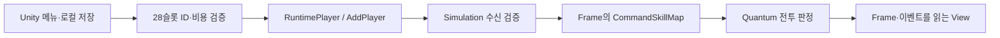

# Look-See-Do Fighter — Quantum 3 리팩토링과 기능 개발 포트폴리오

- 작성일: 2026-10-17
- 정리 범위: 2026-10-16~17에 기록된 AI 협업 개발 작업
- 환경: Unity 6000.3.26f1 · Photon Quantum 3.0.14.2241 · C# · Quantum DSL(.qtn) · NUnit/Unity Test Framework
- 비교 기준: `70e19ab8` → `a959b5bdf5057e2e02c4370f9a69294e8bd1ecd5`

이 문서는 저장소의 소스 변경, 작업 기록, 기존 검증 결과를 종합한 것이다. 기존 게임 전체를 이번 AI 협업의 성과로 산정하지 않는다. 이번 요청에서는 문서만 작성했으며 게임 코드 수정, 테스트 재실행, 커밋·Push는 하지 않았다.

## 포트폴리오 소개문

Photon Quantum 3 기반 2D 격투게임에서 전투 상태의 소유권과 시뮬레이션·표현 계층의 경계를 개선하고, 선입력과 5판 3선승 진행을 구현했습니다. AI와 협업해 기존 코드의 결정론 위험을 조사한 뒤, 로컬 저장소에 의존하던 스킬 선택을 RuntimePlayer 전달 방식으로 바꾸고 플레이어별 버퍼를 Frame 컴포넌트로 옮겼습니다. 37종 공격의 타격 데이터를 불변 정의와 공통 히트박스 생성기로 분리하면서 기존 판정 시점과 직렬화 참조를 보존했습니다.

검증에서는 단위·에셋 계약 검사와 실제 Photon 두 클라이언트 시나리오를 구성했습니다. 최신 검사에서 157개 테스트가 모두 통과했고, 선입력 전달, 5라운드 진행 후 3:2 종료, 입력 기록 재생과 과거 Frame 복원 후 재시뮬레이션의 체크섬 비교를 확인했습니다. 독립 실행 빌드, 교차 플랫폼, 실제 재접속과 강제 네트워크 지터 검사는 후속 검증 범위로 남겼습니다.

## 문제와 목표

기존 프로젝트에는 다음과 같은 구조적 위험과 미완성 동작이 있었다. 초기 감사에서 발견한 소스상 위험을 실제로 재현된 네트워크 오류와 구분했다.

| 기존 문제 | 작업 목표 |
|---|---|
| Simulation이 각 클라이언트의 `PlayerPrefs`에서 스킬을 직접 읽음 | 같은 입력 계약을 통해 로드아웃을 전달하고 수신 시 검증 |
| 공격 시간·카운터 피해에 float 계산 사용 | FP와 정수 연산으로 판정 계산 통일 |
| 공유 공격 에셋에 플레이어별 연타 예약 상태 저장 | 롤백 대상인 Frame에 실행 상태 배치 |
| 공격별 히트박스 생성·수치 코드 중복 | 기존 타격 계약을 보존하면서 불변 데이터와 생성 절차 분리 |
| 이동·피격·체력·접촉 처리가 PlayerSystem에 집중 | 기존 시스템 실행 순서를 유지하며 책임 분리 |
| View의 전역 Runner·static 참조·이름 검색 및 이벤트 수명 문제 | 게임별 명시적 바인딩과 표현 이벤트 소유권 확립 |
| 행동 잠금 중 공격 입력을 다음 행동까지 보관하는 경로 부족 | 방향을 포함한 공격 선입력 구현 |
| 최초 KO 종료 구현이 첫 라운드 결과에서 정지 | 라운드 전환과 3승 매치 종료 구현 |

보존 대상은 기존 공격 수치, Animator 변수·상태명, `.meta` GUID, Quantum asset ID, 시스템 등록 순서였다. 구조 개선과 밸런스 변경을 구분하고, 의도가 확인되지 않은 피해 공식은 유지했다.

근거: [초기 소스 감사](../architecture-audit.md), [잔여 리팩토링 통합 기록](../refactor-remaining-result.md).

## 사람과 AI의 역할

| 구분 | 기록으로 확인할 수 있는 내용 |
|---|---|
| 사용자 요구·운영 결정 | Quantum 3 경계 유지, 기존 변경 보존, 작업당 최종 검증 한 차례, 실패 후 자동 재실행 금지, 게시 전 승인이라는 작업 규칙 |
| 사용자 설정 | 사용자가 조정한 선입력 에셋 값 `20tick`을 보존. 새 설정 객체의 초기값 `10tick`과 구분 |
| AI 협업 산출물 | 구조 감사·백로그, 로드아웃 전달/검증, 전투 수학·상태 이관, 공격 데이터 분리, View 수명 관리, 입력 버퍼·라운드 기능, 테스트·검사 도구, 결과 문서 |
| 기존 프로젝트·외부 기여 | 기존 전투 콘텐츠와 Animator 그래프를 기반으로 작업. Photon Quantum SDK·Animator 애드온, 외부 아트·오디오 제작은 이번 구현 성과와 구분 |
| 기록이 없는 항목 | 개별 설계 아이디어의 최초 제안자, 사람의 세부 코드 검토 내역, 줄 단위 AI 작성 비율은 산정하지 않음 |

커밋 작성자 정보만으로 사람이 직접 작성한 코드와 AI가 작성한 코드의 비중을 판단하지 않았다. 아래 설계 선택은 저장된 구현·작업 기록의 내용이며, 모두 사용자의 최초 아이디어였다고 주장하지 않는다.

사용한 작업 체계는 [AGENTS.md](../../../AGENTS.md), [프로젝트 스킬](../../../Skill.md), [개발 운영 지침](../development-workflow.md), [검증 절차](../validation.md), [Hook.md](../../../Hook.md)다. 이 문서 작성에는 [lsdf-portfolio-evidence](../../../.agents/skills/lsdf-portfolio-evidence/SKILL.md)를 적용했다. 훅 파일 구성과 실제 앱의 자동 호출 여부는 별개이며, 현재 Stop 훅은 등록되어 있지 않다.

## 주요 설계와 구현

### 1. 로컬 스킬 저장과 시뮬레이션 입력 계약 분리

기존에는 스폰 시스템이 `PlayerPrefs`를 직접 읽어 각 캐릭터의 스킬맵을 구성했다. 이를 Unity 메뉴 계층에서 읽고 검증한 뒤 Quantum 3의 기존 `RuntimePlayer`/`AddPlayer` 경로로 전달하도록 바꿨다. Simulation은 `f.GetPlayerData()`로 받은 값만 읽는다.



- 방향 7개 × 버튼 4개의 **28슬롯** 계약을 유지했다.
- 슬롯별 유효 ID와 비용 규칙을 메뉴·전송·수신 경로에서 공유한다. 비용 데이터는 28슬롯 × 3개 후보의 84개 항목이다.
- 배열 길이, ID, 비용 한도를 검증하고 잘못된 값에는 기본 로드아웃/기본 ID를 적용한다.
- 원본 RuntimePlayer 설정을 복사해 사용하고, 반복 AddPlayer로 기존 전투 엔티티가 중복 생성되거나 HP가 초기화되지 않게 한다.
- 로컬 저장은 `Skill_` 키를 우선하고 기존 `SkillMap_` 키를 호환한다. 로드아웃 초기화가 다른 저장값까지 지우지 않게 했다.
- 프로토콜 접미사를 변경해 이전 payload·게임 규칙의 클라이언트와 같은 방에 섞이지 않게 했다. 현재 값은 `lsdf-loadout-v5-best-of-five`다.

기존 메뉴의 같은 슬롯·ID에 서로 다른 비용이 있는 문제는 저장 복원 시 첫 일치 항목의 비용을 공통 기준으로 삼았다. 새로운 스킬 콘텐츠를 임의로 추가하지 않았다.

주요 소스: [LSDFLoadout.cs](../../../Assets/QuantumUser/Simulation/LSDFLoadout.cs), [메뉴 연결 확장](../../../Assets/Photon/QuantumMenu/Runtime/QuantumMenuConnectionBehaviour.LSDF.cs), [스폰 시스템](../../../Assets/QuantumUser/Simulation/LSDF_PlayerSpawnSystem.cs).

### 2. 결정론 계산과 실행 상태의 소유권 정리

공격 37종과 Air 이벤트의 애니메이션 시간 환산을 `LSDFCombatMath.AnimationFrame`으로 모았다. 계산은 `FP × 60`의 정수 변환이며, 60은 기존 애니메이션 저작 기준이다. 세션 주기를 바꾸는 작업은 아니었다. 카운터 피해는 정수 비율 `damage × 6 / 5`로 처리한다.

잽 계열의 `BufferedNextAttack`은 공유 에셋에서 `.qtn` 플레이어 컴포넌트로 옮겼다. 매 호출마다 계산할 수 있는 `currentFrame`은 지역변수로 바꾸고, 충돌의 임시 가드 결과를 static 필드에 저장하던 경로를 제거했다. `.qtn` 변경은 설치된 Quantum CodeGen으로 생성했다.

이 선택의 핵심은 **게임 결과에 영향을 주며 프레임을 넘어 유지되는 값은 Frame이 소유한다**는 것이다. 불변 설정과 호출 중 임시값은 실행 상태와 구분했다. 과거 float 계산과 FP 계산이 모든 경계에서 동일하다고 가정하지 않고, 타격 경계·정수 버림 규칙을 테스트 대상으로 삼았다.

주요 소스: [LSDFCombatMath.cs](../../../Assets/QuantumUser/Simulation/LSDFCombatMath.cs), [플레이어 스키마](../../../Assets/QuantumUser/Simulation/LSDF_Player.qtn). 설계 이력: [P0 기록](../refactor-p0-result.md).

### 3. 37종 공격을 불변 데이터와 공통 생성기로 이관

기존 공격 이벤트의 타입·GUID·asset ID와 Animator 연결은 유지하면서, 타격 수치를 직렬화된 정의로 분리했다. 이벤트는 기존 이동·연계·종료 동작을 담당하고 히트박스 생성은 `LSDFHitboxFactory`를 사용한다.

| 구성 요소 | 책임 |
|---|---|
| `LSDFSingleHitDefinition` | 피해·경직·높이·위치·크기·반응 속성 등 불변 타격 설정 |
| `LSDFTimedHitDefinition` | 다단히트의 생성 애니메이션 프레임과 각 타격 정의 |
| `LSDFHitboxFactory` | Transform·Collider·HitboxInfo·파괴 tick 구성 |
| 기존 공격 이벤트 | 공격별 이동·회피·연타 전이 등 기존 동작 연결 |

왼어퍼 1종 → 잽 4종 → 다단히트 2종 → 나머지 30종 순서로 전체 37종을 이관했다. 보존한 계약에는 `StartupFrames - 1` 생성, 생성 tick+1 파괴, 좌우 반전, FP raw 값, 판정 속성이 포함된다.

다단히트의 실제 생성 시각과 피격 메타데이터는 별도로 유지했다. 예를 들어 나락 둘째 타는 애니메이션 35프레임에 생성되지만 기존 `startFrame=18`을 보존했다. 공유 에셋에 실행 커서를 추가하지 않고 현재 애니메이션 프레임으로 생성 여부를 계산한다.

기존 Lars 계열 일부 효과 좌표가 원점인 동작과 MachineGun의 중복 collider Add 호출은 구조 이관 과정에서 임의로 고치지 않았다. 37종 모두를 온라인 대전에서 전수 검증한 것은 아니며, 온라인 시나리오는 잽·어퍼·나락·Lars 등 대표 기술을 다룬다.

주요 소스: [단타 정의](../../../Assets/QuantumUser/Simulation/LSDFSingleHitDefinition.cs), [다단히트 정의](../../../Assets/QuantumUser/Simulation/LSDFTimedHitDefinition.cs), [생성기](../../../Assets/QuantumUser/Simulation/LSDFHitboxFactory.cs). 근거: [4차 기록](../refactor-phase4-result.md), [원본 공격 계약 데이터](remaining-attack-contracts.json).

### 4. 전투 책임 분리와 View 수명 관리

PlayerSystem은 기존 시스템 하나를 유지하면서 이동, 피격 시그널, 접촉, 체력 정책으로 책임을 나눴다. partial 분리를 새로운 Quantum 시스템 등록으로 취급하지 않았으며, 물리·Animator·명령·파괴 순서를 유지했다.

- `LSDFPlayerMotion`: 이동·대시·콜라이더 처리.
- `LSDF_PlayerSystem.Combat.cs` / `.Contacts.cs`: 피격 및 벽·바닥 접촉 처리.
- `LSDFPlayerHealth`: Frame 컴포넌트를 받아 피해·회복 계산.
- `LSDFContactPolicy`: 회피→벽→카운터→스턴→콤보→가드→패링 우선순위.
- `LSDF_GameConfig` / `LSDFBalance`: HP·이동·스폰·비용 등 실제 밸런스 값의 설정과 조회.

View는 별도 `LSDF.View` 어셈블리로 정리했다. `LSDFSceneBindings`가 EntityViewUpdater별 카메라·HUD·전투 엔티티를 연결하고, 게임별 HUD·VFX·SFX 담당을 정한다. 예측 이벤트는 키로 추적해 취소 시 효과를 제거하거나 오디오를 중지하고, 확정 시 추적 정보를 해제한다. 비활성화와 게임 변경 시 구독·참조도 정리한다.

비어 있던 MonoBehaviour 4종은 GUID와 타입명을 보존해 View/Legacy로 이동했다. Down 입력에 UpArrow가 연결되던 매핑 오류도 수정했다. Quantum SDK 코어와 Animator 애드온은 수정하지 않았고, 사용자 메뉴가 섞인 QuantumMenu의 기존 연결 지점은 프로젝트 확장을 호출하도록 최소 변경했다.

근거: [5차 기록](../refactor-phase5-result.md), [통합 기록](../refactor-remaining-result.md). 주요 소스: [씬 바인딩](../../../Assets/QuantumUser/View/LSDFSceneBindings.cs), [표현 이벤트 추적](../../../Assets/QuantumUser/View/LSDFPresentationLedger.cs).

### 5. Frame 기반 공격 선입력

공격 버튼을 새로 누른 순간의 방향·버튼·tick을 저장하고, 행동 잠금이 풀리면서 Animator가 명령을 받을 수 있는 첫 CommandSystem tick에 전달하도록 구현했다.

- 플레이어당 최신 명령 1개를 유지한다. 새 입력은 대기 명령을 교체한다.
- 키를 놓거나 방향을 바꿔도 입력 당시 커맨드는 유지한다. 홀드만으로 예약 시간을 갱신하거나 공격을 반복하지 않는다.
- `현재 tick - 입력 tick <= N` 경계를 사용한다. N은 실행을 늦추는 대기 시간이 아니다.
- 대기 명령과 Animator로 전달 중인 명령을 구분한다. 여러 tick에 걸친 기존 그래프 경로에서 승인된 명령이 사라지지 않게 한다.
- KO·라운드 전환 시 버퍼를 비우고, 이전 라운드부터 누른 버튼을 새 공격으로 등록하지 않는다.
- 현재 설정 에셋의 유지 시간은 **20tick**, 새 설정 객체의 초기값은 **10tick**이다. 그래프 전달 안전 한계 16tick은 별도 값이다.

모든 지속 상태는 `LSDF_CommandBuffer.qtn`에 둔다. 시스템 필드나 공유 에셋에 입력 기록을 저장하지 않는다. 최신 온라인 검사에서는 두 클라이언트 모두 **입력 tick 384 → 전달 tick 392**를 관측했고, 키를 놓은 뒤 LeftUpper 생성까지 확인했다. 이 8tick 차이는 해당 잠금 시나리오의 관측값이며 성능 개선률이나 전체 입력 지연 측정값이 아니다.

주요 소스: [입력 버퍼](../../../Assets/QuantumUser/Simulation/LSDFInputBuffer.cs), [버퍼 스키마](../../../Assets/QuantumUser/Simulation/LSDF_CommandBuffer.qtn), [명령 전달](../../../Assets/QuantumUser/Simulation/LSDFCommandProcessor.cs). 근거: [선입력 기록](../input-buffer.md).

### 6. KO 확정에서 5판 3선승 매치까지 확장

HP 0 이하에서 라운드 결과를 한 번 확정하고, 3승 전에는 다음 라운드로 진행하도록 구현했다. 동시 KO는 무득점이며 같은 라운드 번호로 재시작한다. 최대 5회라는 조건은 승패가 결정된 라운드에 적용한다.

```text
전투 → KO·승점 확정 → 결과 표시 120tick
     → HP·위치·전투 상태 초기화 → 인트로 150tick → 전투
     └ 3승 도달 → 최종 YOU WIN / YOU LOSE 유지
```

승점·스킬맵은 다음 라운드에도 유지하고 콤보·대시·벽·공격·입력 상태는 초기화한다. 결과/인트로 시간은 Quantum tick으로 판정하며 UI 코루틴이 경기 진행을 결정하지 않는다. HUD 결과는 VerifiedFrame을 기준으로 표시한다.

패자는 기존 Quantum Animator의 `Sit Enter → Siting`을 거친 뒤 자세를 고정하고 승자는 Idle로 전환한다. 기존 클립·그래프·SDK를 바꾸지 않고 전환 잠금 시점을 조정했다. 라운드 상태는 기존 Frame 필드와 Animator LayerData를 사용하므로 이 기능 자체에는 QTN 변경이 필요하지 않았다.

최신 온라인 검사는 5번의 KO, 4번의 초기화·인트로, 5번의 앉기 전환, 3:2 최종 종료 후 최소 240 verified tick 유지까지 확인했다.

주요 소스: [라운드 정책](../../../Assets/QuantumUser/Simulation/LSDFRoundPolicy.cs), [경기 시스템](../../../Assets/QuantumUser/Simulation/LSDF_IngameSystem.cs), [HUD](../../../Assets/QuantumUser/View/LSDF_IngameUI.cs). 근거: [5판 3선승 기록](../best-of-five.md). 최초 단일 KO 종료는 [이전 구현 이력](../ko-result.md)이며 현재 동작과 구분한다.

## 검증 결과와 재현 근거

아래는 **2026-10-17 게시 전 후보 검증 당시의 결과**다. 문서 작성을 위해 다시 실행하지 않았다. 원본 요약: [fighter-publish-validation.json](fighter-publish-validation.json).

| 검사 | 결과 | 범위·조건 |
|---|---|---|
| Unity 컴파일 | PASS | 오류 0, 기존 obsolete 경고 2건 |
| LSDF.Tests 전체 | **157 PASS / 0 FAIL / 0 SKIP** | EditMode 묶음에 PlayMode 진입·실제 Photon 연결 포함, 182.09초 |
| Quantum 정적 정책 | PASS | Simulation C# 91개, 기존·신규 어휘 패턴 적중 0 |
| 실제 Photon 두 클라이언트 | PASS | 같은 Editor 프로세스의 독립 연결 2개·Quantum 세션 2개 |
| 입력·전투·매치 | PASS | 서로 다른 로드아웃, 반복 AddPlayer, 대표 타격, 선입력, 3:2 매치 진행 |
| 입력 기록 재생 | PASS | 같은 기록을 두 번 재생해 verified-frame checksum 비교 |
| 과거 Frame 복원 | PASS | 대기 입력이 있는 Frame을 직렬화·ResetReplay하고 같은 입력으로 재시뮬레이션해 checksum 비교 |
| 게시 후보 검사 | 알려진 패턴 탐지 0 | staged 파일 39개 및 기존 미게시 커밋 범위, 총 198개 blob 검사. 비밀정보 부재를 보증하는 검사는 아님 |
| diff 서식 | 생성물 공백 경고 보존 | SDK 생성 코드 2개 위치의 줄 끝 공백. Generated 직접 수정 금지에 따라 보존했으며 PASS로 바꾸지 않음 |

테스트 구성은 결정론 계약 18, 선입력 31, 잽 정의 4, 온라인 통합 1, 체력 24, 잔여 공격 계약 30, 라운드 결과 19, 단타 5, 구조 20, 다단히트·LUT 5로 총 157개다. 온라인 테스트 1개 안에 여러 단계의 assertion이 포함된다. 단계 수를 별도 테스트 개수로 더하지 않았다.

초기 정적 검사에는 78개 파일에서 156건의 규칙 적중이 있었고, 중간에는 5건, 최신 검사에서는 91개 파일에서 0건이었다. 파일 구성과 검사 범위가 달라졌으므로 이 수치를 동일 조건의 개선율로 계산하지 않는다. 규칙 적중은 서로 겹칠 수 있으며 고유 버그 개수, 버그 해결률, 성능, 결정론 보증을 뜻하지 않는다.

최신 온라인 관측에서 양쪽의 KO tick은 `2871, 4491, 6111, 7731, 9351`로 일치했다. 최종 패배 수는 PlayerRef 0/1 기준 `3/2`였으며 상대 패배 수를 자신의 승수로 해석한다.

재현 기준은 다음과 같다. 아래 명령·절차는 기존 검사를 재현할 때의 안내이며 이번 문서 작업에서 실행한 검사가 아니다.

- 환경: Unity 6000.3.26f1, Quantum 3.0.14.2241, 대상 커밋 `a959b5bd`.
- 정적 정책: 프로젝트 루트에서 `python tools/ai/quantum_guard.py check`.
- 테스트: Unity Test Runner의 EditMode에서 `LSDF.Tests` 전체 실행. 온라인 검사는 기존 프로젝트의 유효한 Photon 연결 설정과 네트워크 접근이 필요하다. 인증값은 문서에 포함하지 않는다.
- 온라인 fixture: [LSDFOnlineSmokeTests.cs](../../../Assets/Tests/Editor/LSDFOnlineSmokeTests.cs), seed `12345`, 입력·체크섬 기록 활성화. SessionConfig 에셋 값은 UpdateFPS 60, ChecksumInterval 60이다.
- 테스트 job ID: `43a31becf2a1483c8def35772cc9be78`.
- 검증된 `Assets/QuantumUser` Git tree: `78a4d7d3307139fbf63398a0db712c90300c09e6`.
- 검증된 `Assets/Tests` Git tree: `cf163f4de0cbf1e22ac491418ec2466124a21ae7`.

문서 작성 시 두 subtree 식별값이 현재 HEAD와 일치하는 것을 확인했다. 이 Git tree 값은 해당 폴더의 소스·에셋 식별값이며 전체 Quantum Asset DB 해시가 아니다. 보관된 최신 JSON은 재생·복원 assertion 통과를 기록하지만, tick별 raw checksum 전체와 영구 리플레이 파일은 첨부하지 않는다.

## 실패를 분석하고 검증 범위를 관리한 사례

| 관측한 실패 | 조사·수정 | 이후 근거 |
|---|---|---|
| 테스트 어셈블리의 Photon.Deterministic 참조 누락·Assert 이름 충돌 | 설치 DLL 참조 명시, NUnit Assert 별칭 사용 | 후속 컴파일·계약 검사 통과 |
| 온라인 세션 시작 timeout·네트워크 Service 공백 | 백그라운드 실행 보완, 각 연결 직후 세션 시작 예약 | 이후에는 다른 초기화 오류까지 도달. 단일 원인 해결로 단정하지 않음 |
| `FPMath.SqrtRaw` 초기화 예외 | 누락된 QuantumLookupTables 전역 에셋과 6개 LUT 참조 구성 | LUT 참조 검사 및 이후 온라인 검사 통과 |
| 이름 없는 테스트 씬의 `previousSceneName` 예외 | 테스트 동안만 자동 씬 로드 비활성화 후 복원 | 이후 온라인 시뮬레이션 검사 통과 |
| 공격 계약 테스트 2개의 타입명 불일치 | 파일명과 실제 클래스명 차이를 기준 데이터에 반영. 게임 타입·assertion 유지 | 사용자 요청으로 해당 2개만 재실행해 2 PASS. 당시 전체 재실행으로 표현하지 않음 |
| 선입력 테스트가 실제 설정값을 10으로 고정 | 기본 생성값과 사용자 에셋 값 20의 검증을 분리 | 후속 전체 회귀에서 InputBuffer 31개 통과 |
| 5라운드 뒤 재생 단계에서 180초 제한 초과 | 외부 제한 360초·내부 취소 300초 확보, 게임 assertion·매치 진행 제한 유지 | 새 게시 요청의 검증에서 전체 157개 통과 |

각 작업의 최초 실패는 기록에 남겼고, 수정 후 바로 재실행하지 않은 경우에는 당시 `수정 후 미검증`으로 보고했다. 이후 사용자 요청으로 실행한 검증은 별도 결과로 남겼다. 최신 PASS가 이전 실패 이력을 덮어쓰지 않게 했다.

근거: [2차](../refactor-phase2-result.md), [3차](../refactor-phase3-result.md), [4차](../refactor-phase4-result.md), [잔여 2건 재검증](refactor-remaining-retry.json), [선입력](../input-buffer.md), [5판 3선승](../best-of-five.md).

## 결과와 남은 범위

완료한 범위는 로드아웃 전달 계약, Frame 상태 이관, 37종 공격 데이터 분리, 전투 책임·View 수명 정리, 선입력, KO·라운드 전환·3승 매치 종료, 그리고 이를 확인하는 테스트와 작업 기록이다. HP·위치·입력 초기화와 최종 종료를 두 온라인 세션에서 확인했다.

다음 항목은 완료 성과에 포함하지 않는다.

- 강제 네트워크 지터·지연 주입을 통한 예측 rollback: NOT RUN. 기록 재생·과거 Frame 복원 검사와 구분한다.
- 독립 실행 빌드, 교차 플랫폼 결정론, 실제 연결 해제·재접속, 사람이 보는 양쪽 HUD·VFX·SFX: NOT RUN.
- 성능·메모리·FPS·입력 지연의 동일 조건 전후 비교: 미측정. 테스트 실행 시간 182.09초는 게임 성능 지표가 아니다.
- 모든 37종 공격의 온라인 조합 전수 검사, SDK·씬·Animator 전체 전수 감사: 수행하지 않음.
- 제한시간 종료, 재대전, 이탈 승패, 메뉴 placeholder 콘텐츠 완성: 후속 기능 범위.
- 기존 hitCount 1·3의 일반 피해 0 분기, 일부 원점 효과 좌표·중복 collider 호출: 의도 확인 또는 별도 수정 필요.

AI 활용 성과는 프롬프트 수나 생성 코드량 대신 상태 소유권, 보존한 계약, 실패 원인 분석, 재현 가능한 검사 결과로 설명한다. 사람이 실제로 수행한 플레이 확인·코드 검토·설계 결정의 상세가 추가되면 해당 근거를 붙여 기여 설명을 보완할 수 있다.

### 같은 날의 후속 작업

위 본문의 기준 커밋 이후 피격 대상 체력바 흔들림, 접속 종료 진단, 사용자별 기술 조합 회귀 검사를 추가했다. 사용자가 흔들림 강도를 20으로 조정한 게시 후보에서 전체 **235개 테스트가 통과**했다. 메뉴·직렬화 검사 74개와 서로 다른 기술 10개 경로를 실행하는 Photon 시나리오가 포함된다. 최초 사용자 환경의 접속 종료 원인은 미확정이다.

별도 근거: [체력바 연출](../health-bar-shake.md), [로드아웃 조사와 후속 결과](../loadout-isolation.md), [후속 후보 검증](health-shake-publish-validation.json). 이 후속 결과를 위의 이전 157개 검사와 더해 서로 독립된 테스트 개수로 계산하지 않는다.

## 작업 이력

| 커밋 | 날짜 | 작업 묶음 |
|---|---|---|
| `64a37db6` | 2026-10-16 | 초기 감사, 규칙·스킬·훅·정적 검사 체계 |
| `acfb3f23` | 2026-10-16 | 로드아웃·결정론·초기 공격 정의 리팩토링, 검증·게시 절차 |
| `ffcc3566` | 2026-10-16 | 전투 시그널과 체력 정책 분리 |
| `3f45e7d1` | 2026-10-16 | 잔여 공격·메뉴·View·전투 구조 및 재생/복원 검사 |
| `a959b5bd` | 2026-10-17 | 선입력, KO 결과, 5판 3선승과 라운드 전환 |

위 표는 로컬 Git에 존재하는 작업 묶음이다. 원격 게시 상태나 PR 생성 여부를 커밋 존재만으로 추정하지 않는다.

## 면접 설명 예시

“가장 먼저 고친 부분은 게임 상태가 어디에 저장되는지였습니다. 기존에는 스킬을 로컬 저장소에서 직접 읽고, 연타 예약을 공유 공격 에셋에 저장했습니다. Quantum의 입력 전달 경로와 Frame 컴포넌트로 각각 옮겨 두 클라이언트가 같은 상태를 재현하도록 구조를 바꿨습니다.

그다음 37종 공격을 데이터와 생성기로 분리했습니다. 이때 단순 중복 제거보다 기존 타격 시점, FP 버림, GUID와 Animator 참조를 보존하는 데 집중했습니다. 선입력과 3선승 진행도 같은 상태 소유권 원칙으로 구현했습니다.

AI는 코드 조사와 구현·테스트 작성을 보조했고, 결과는 실제 에셋 계약과 Photon 두 세션의 실행으로 확인했습니다. 최신 전체 검사 157개가 통과했고, 입력 기록 재생과 과거 Frame 복원 뒤 체크섬 비교도 통과했습니다. 다만 강제 네트워크 지터나 교차 플랫폼까지 검증했다고 말하지는 않습니다.”
